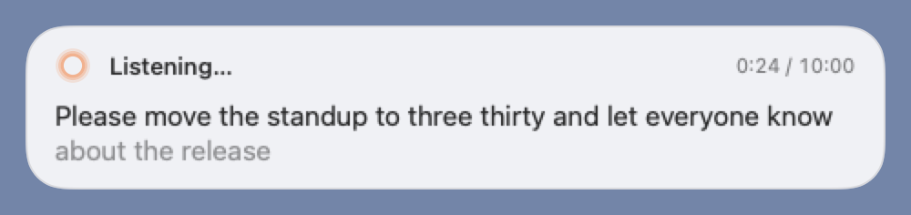
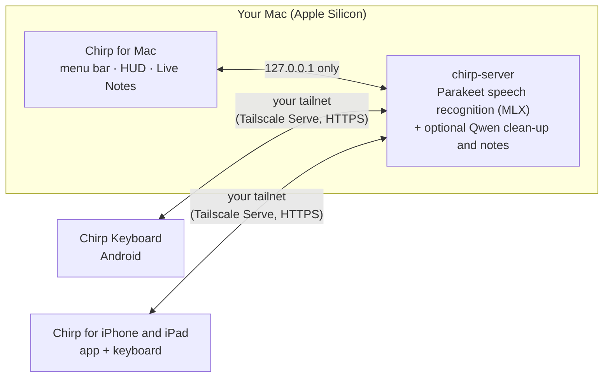

<p align="center">
  
</p>

<h1 align="center">Chirp</h1>

<p align="center"><strong>Talk anywhere. Type nowhere.</strong></p>

<p align="center">Local-first voice dictation for your Mac, Android and iPhone — speech recognition runs on your own Mac. Your words stay yours.</p>

<p align="center"><a href="https://araa47.github.io/chirp/">Website</a> · <a href="#get-it-running">Get it running</a> · <a href="#how-fast">How fast</a> · <a href="docs/README.md">Docs</a></p>

<table>
  <tr>
    <td align="center" width="25%"><a href="docs/screenshots/mac/hud-listening-light.png"></a><br><sub>Mac · dictate in any app</sub></td>
    <td align="center" width="25%"><a href="docs/screenshots/mac/notes-split-dark.png"></a><br><sub>Mac · Live Notes</sub></td>
    <td align="center" width="25%"><a href="docs/screenshots/android/keyboard-look-gboard-listening-light.png"></a><br><sub>Android · keyboard</sub></td>
    <td align="center" width="25%"><a href="docs/screenshots/android/scratchpad-text-light.png"></a><br><sub>Android · Scratchpad</sub></td>
  </tr>
</table>

Press a hotkey on your Mac, or the mic key on your phone, and talk. Your words appear live in whatever text field you're using, and on the Mac the final text replaces them about a tenth of a second after you stop. You can have a local model tidy up fillers and punctuation, or leave the mic open in a meeting and get structured Markdown notes. Everything runs on a Mac you own. Your phone reaches that Mac over your own Tailscale network, and no other server is involved.

## Why Chirp

| | Chirp |
|---|---|
| **Your data stays yours** | Everything runs on devices you own. There's no Chirp cloud, no account and no telemetry, so your audio and text are never sent to us or anyone else. You decide what's kept: no history at all (the default), or an encrypted history on your phone for 24 hours, 7 days or 30 days. |
| **No subscription, no account** | Open source models (Parakeet for speech, an optional Qwen model for clean-up) run on your Apple Silicon Mac. |
| **Your phone too** | An Android keyboard and an iPhone/iPad app use the same Mac, so you get the same accuracy and the same clean-up styles on every device. |
| **Notes, not just dictation** | Live Notes turns a long conversation into headings, bullets, to-dos and decisions you can edit while it writes. |
| **Yours to build and change** | The Mac installs from source with one script. Prompts, styles, hotkeys and models are all editable. |

**How it compares.** Cloud dictation tools such as Wispr Flow and Typeless, and meeting-notes services such as Otter and Granola, process your audio on their own servers and generally charge a subscription. Apple Dictation and Gboard voice typing are free, but they're tied to one platform and don't offer Chirp's clean-up styles or live notes. Superwhisper also runs locally, but it's closed source with paid tiers. Chirp's bet is that one Mac you already own can do all of this, privately, for every device you type on.

**Honest limits.** You need an Apple Silicon Mac that's on and reachable whenever you dictate. Phones connect only through Tailscale. Everything is installed from source: there's no notarized Mac download, no Play Store build and no App Store build. The iPhone/iPad app passes its simulator tests but hasn't been run on a real device yet.

## How it works



The Mac runs one speech server that listens only on `127.0.0.1`. The Mac app streams microphone audio to it directly. The phone apps only record audio, stream it, and insert the text that comes back. They reach the server through `tailscale serve`, which keeps it on your private tailnet, never the public internet. Pairing is a secret QR code shown on the Mac. Protocol and privacy rules: [docs/architecture.md](docs/architecture.md).

## How fast

Measured on an Apple M5 Pro (64 GB, macOS 27) through the real WebSocket path with Chirp's default models. These are observed results, not guarantees. Sources and methods: [docs/bench.md](docs/bench.md).

| What | Measured |
|---|---|
| First live words on screen | **196–244 ms** after audio starts streaming (5.85 s clip, contended vs. quiet host) |
| Stop → final text | **96–107 ms** (same clip); full re-decode of a 15 s utterance: 222 ms median |
| Speech recognition speed | **88–113× real time** when warm (Parakeet v2, MLX) |
| Clean-up, model already loaded | **~400 ms** median (Qwen3 4B, 59 test cases, 100% passed) |
| Clean-up, first use after idle | **~1.7 s** median on a busy host, because the model starts loading while you're still talking |
| Live Notes update | **2.2 s** median for ~800 characters of transcript, **5.2 s** for ~2,400 |

Phone latency over Tailscale hasn't been measured on a real device yet. The Android keyboard keeps content-free per-session timings in Setup → Diagnostics, and [docs/android-device-acceptance.md](docs/android-device-acceptance.md) is the checklist for recording them.

## Features

**Mac** — [mac/README.md](mac/README.md)
- Dictate into any app with ⌃⌥Space or any shortcut you record, including ⌥ or fn on its own. Choose auto-stop when you pause, or hold to talk. Esc cancels.
- A floating HUD shows the live transcript. Text is typed straight into the field, or pasted, or copied if neither works.
- Optional clean-up with styles for chat, email, code and notes, per-app styles and editable prompts. **Use raw** puts back the original with one keystroke.
- **Live Notes** (⌃⌥N) turns a meeting into editable Markdown notes next to the transcript, with automatic organizing and optional on-device speaker labels. Save or copy them; until then a text-only recovery copy stays on this Mac (never audio), so a crash doesn't lose the meeting, and Save or Discard deletes it.
- A model manager downloads, switches and updates speech and clean-up models. **Pair a Phone** checks Tailscale Serve and shows the pairing QR code.

**Android** — [android/README.md](android/README.md)
- A full HeliBoard keyboard with a mic key. Live text appears underlined, and the final replaces it. Looks like Gboard by default, with a Samsung-style option and a layout tuned for the Galaxy Z Fold.
- Dictated text is never lost: if a dictation fails, the keyboard keeps what it heard, and Undo and Use raw are one tap away. Long dictations run up to 10 minutes. You can stop on pause, use spoken "new line" commands, and start or stop with Ctrl+Alt+Space on a hardware keyboard.
- **Scratchpad** for long-form dictation outside any text field, opened from a Quick Settings tile or the launcher shortcut. Copy or share the result.
- Shows when the Mac is offline, offers a "Tailscale is off · Turn on" prompt, can install updates from your Mac over the tailnet, and keeps opt-in dictation history encrypted on the phone.

**iPhone and iPad** — [ios/README.md](ios/README.md)
- A SwiftUI app plus a dictation-first custom keyboard for iOS/iPadOS 18, paired by QR to the same Mac.
- Companion controls (Action Button, Control Center, Shortcuts, Live Activity), shortcuts for iPad hardware keyboards, and opt-in encrypted history.
- Status: builds and passes its unit and UI tests on iPhone and iPad simulators. It hasn't been signed or run on a device yet.

**Server** — [server/README.md](server/README.md)
- Parakeet TDT v2 (English, default) or v3 (multilingual) via MLX. An ONNX CPU engine and a SenseVoice backend for Mandarin and English are also available.
- Named, revocable per-device pairing tokens, a `doctor` health check, and a documented streaming API.

## Get it running

You need an Apple Silicon Mac. For a phone you also need [Tailscale](https://tailscale.com) on both the Mac and the phone.

### Build it with your coding agent

The fastest path is to open this repository in a coding agent such as Claude Code or Codex and paste:

> Install Chirp on this Mac from this checkout. Follow `README.md` → "Get it running", `mac/README.md` and `scripts/install-mac.sh`. Install any prerequisites that are missing (uv, Command Line Tools), run the installer, then tell me what to click in **Models on this Mac** and which permissions to grant. Then set up my Android phone: follow `android/README.md` → Install, using `android/scripts/setup-toolchain.sh`, a one-time signing key from `android/scripts/make-keystore.sh` and `./gradlew assembleRelease`, and install the **arm64** APK with `adb install -r` (or Taildrop). Finally, have me open Chirp → Settings → Devices → **Pair a Phone…** on the Mac and scan the QR code. Ask before changing Tailscale settings, never enable Funnel, and never paste pairing links or tokens into chat or logs.

For iPhone or iPad, point the agent at [ios/README.md](ios/README.md) → Install. That path needs full Xcode and your own Apple signing team.

### Or by hand

1. **Mac.** Install [uv](https://docs.astral.sh/uv/getting-started/installation/) and the Command Line Tools (`xcode-select --install`), then run:
   ```sh
   ./scripts/install-mac.sh          # server in ~/Library/Application Support/Chirp, Chirp.app in ~/Applications
   ```
   In **Models on this Mac**, download a speech model (optionally a clean-up model too), then click **Start Local Server**. Grant Microphone and Accessibility in Set Up Chirp, then press **⌃⌥Space** in any text field. The installer doesn't need Nix, dotfiles or Tailscale, and it doesn't download any models until you choose them. Details, including `--server-only`: [mac/README.md](mac/README.md#install) and [server/README.md](server/README.md).
2. **Android.** Build the signed release APK and install the arm64 split:
   ```sh
   android/scripts/setup-toolchain.sh && source ~/.local/share/chirp-android/env.sh
   cd android && scripts/make-keystore.sh   # once; never replace a key that is already installed
   ./gradlew assembleRelease
   adb install -r app/build/outputs/apk/release/app-arm64-v8a-release.apk
   ```
   On the phone, enable Chirp Keyboard and allow the microphone. Then pair by scanning the QR code from the Mac's **Pair a Phone…** (or from `uv run chirp-server pair --name "My phone" --url https://<your-mac>.<tailnet>.ts.net/chirp`). Full guide: [android/README.md](android/README.md).
3. **iPhone / iPad.** See [ios/README.md](ios/README.md) for requirements, same-team signing, Full Access and pairing.

## Privacy

**Your data stays yours.** Chirp has no servers of its own: your Mac is the server. Audio and transcripts travel only between your own devices, over your own private Tailscale network, and are never sent to us or any third party. There's no account and no telemetry.

**You choose what's kept.**
- **Nothing** — the default. Audio and text live in memory for one dictation, then they're gone.
- **Recent history on your phone** — turn it on to reinsert past dictations; it's encrypted on the device and kept for 24 hours, 7 days or 30 days, up to 200 entries. Clear it any time.
- **Live Notes** stay in the window until you save or copy them; a crash-recovery copy on your Mac (on by default, deleted when you save) means a crash doesn't cost you a meeting.

**Under the hood.** The speech server listens only on your Mac's loopback address, phones reach it only through your tailnet, and every device is paired with a secret token that you can revoke per device. Clean-up runs on the same Mac; if you deliberately point it at another endpoint, every client says where text is going. A debug mode that keeps recordings exists for troubleshooting, is off unless you start it, and shows a red warning everywhere while it's on. Full details: [docs/privacy.md](docs/privacy.md).

## Repository and docs

```
server/   Speech server: Python 3.13, Starlette, parakeet-mlx (uv project) + tests and benchmarks
mac/      Chirp for Mac: Swift 6 / SwiftPM / AppKit menu-bar app
android/  Chirp Keyboard: HeliBoard-based Android IME + setup app
ios/      Chirp for iPhone and iPad: SwiftUI app + dictation keyboard
docs/     Architecture, benchmarks, privacy, testing, milestones (indexed in docs/README.md)
scripts/  Standalone Mac installer and the cross-component end-to-end check
```

[Architecture](docs/architecture.md) · [Benchmarks](docs/bench.md) · [Privacy](docs/privacy.md) · [Testing](docs/TESTING.md) · [Milestones](docs/milestones/README.md) · [All docs](docs/README.md) · Screenshots: [Mac](docs/screenshots/mac/) · [Android](docs/screenshots/android/)

## Licensing

- **Chirp's own code** (server, Mac app) has no license file yet; it is a personal-use project. No license is claimed for it here.
- **Chirp Keyboard for Android** combines GPL-3.0 HeliBoard code with Chirp's Android client. This is a personal-use build; the corresponding source is available in this repository, and upstream copyright and license notices are kept intact. See the [pinned upstream record](android/keyboard/UPSTREAM.md) and [Android build instructions](android/README.md).
