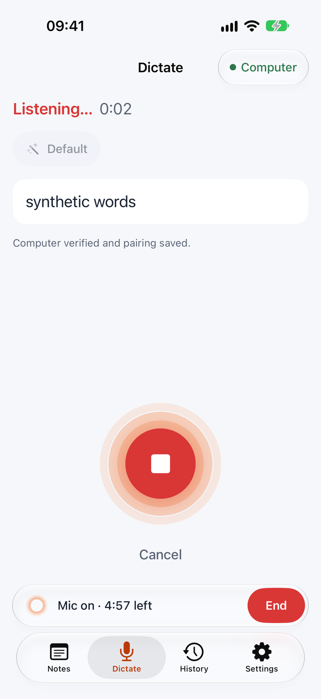
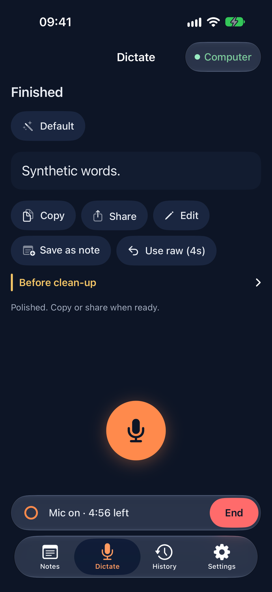
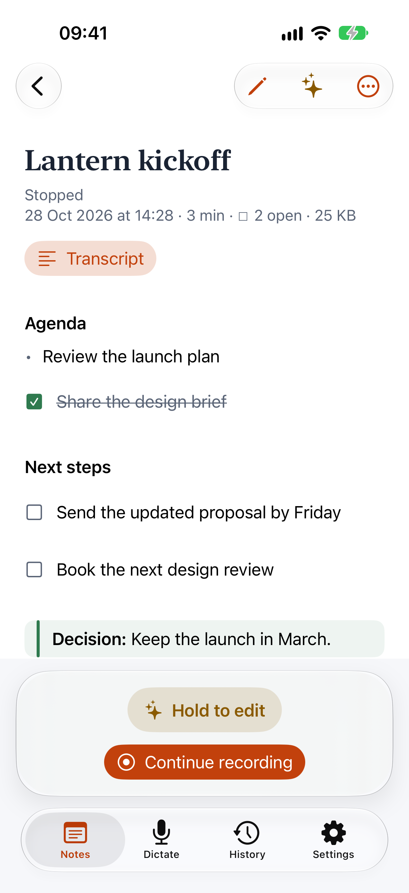
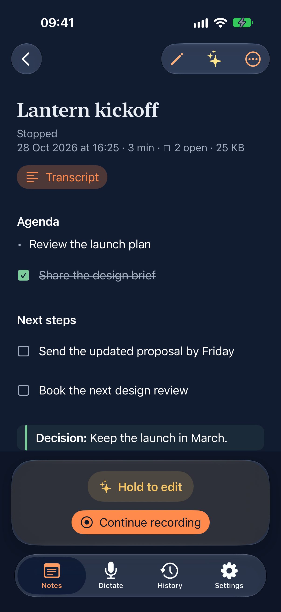
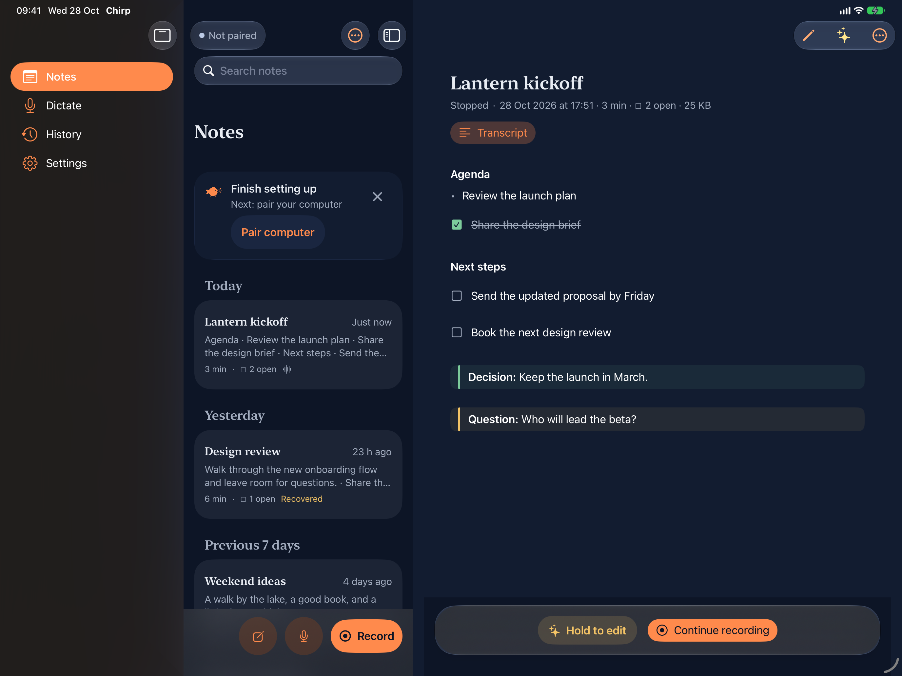
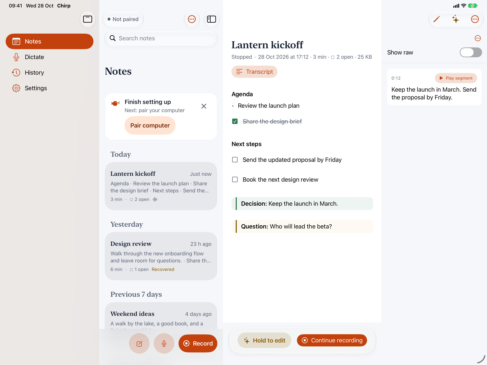
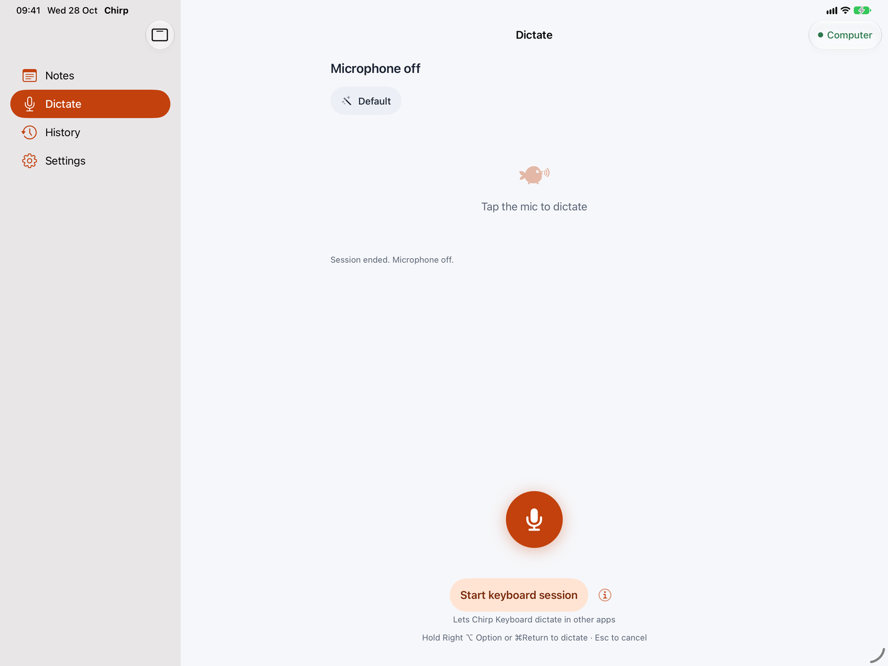

# Chirp for iPhone and iPad

A native SwiftUI app plus a dictation-first custom keyboard for iOS/iPadOS 18.
Recognition and optional clean-up run on your existing Chirp server — the
iPhone or iPad only captures audio, streams it over your tailnet, and inserts
text. Dictation stays transient by default; Notes save continuously to an
AES-GCM sealed library on this device, kept forever unless you choose retention
or delete them. Dictation history and kept Notes audio are separate opt-ins.
Pairing is a secret QR
shown locally on the computer, the iOS client's pairing accepts only tailnet
`.ts.net` hosts, and the server itself binds to loopback — a public host is
never used.

This is a **personal install** target. No App Store distribution, TestFlight or
ad-hoc readiness is claimed or tested.

## Status: runs end to end on iPhone and iPad simulators; first iPad install done (2026-10-25)

The app, keyboard and widgets **build** with full Xcode, and the unit and UI
tests **pass on an iPhone and an iPad simulator**. The UI tests include a
**live run against a real local chirp-server** (throwaway HOME, port 7899,
real Parakeet model, spoken `say` audio) and the **real installed Chirp
Keyboard** dictating into Messages.

**First device install (2026-10-25):** an iPad Pro 13-inch (M4) on iPadOS 26.7.1,
free Personal Team signing, installed with `xcrun devicectl device install app`.
The app launched and paired, Chirp Keyboard turned on with Full Access, and
the keyboard's **Open Chirp to start session** button opened Chirp and armed a
session. On-device dictation quality, Live Notes and an iPhone install are
still unchecked.

| Check (2026-10-24, iOS 27.0 simulators) | Result |
|---|---|
| `ios/scripts/simulator.sh build` — iPhone 18 Pro and iPad Pro 13-inch (M5) | BUILD SUCCEEDED on both |
| `ios/scripts/simulator.sh test` — same two simulators | 20 tests in 2 suites, both |
| `CHIRP_E2E_APPEARANCE=dark ios/scripts/simulator-e2e.sh` (full UI scheme plus live server) — same two simulators | 11 tests, both: 9 pass, 2 skip with stated reasons (⌘ shortcuts need a hardware keyboard on the simulator; UI tests cannot open Spotlight); server log transcript-free |
| `swift test --package-path ios/Keyboard/Policy` | 108 tests in 17 suites |
| `ios/Shared/scripts/test.sh` | 22 tests in 6 suites |
| `ios/scripts/check-sources.sh` | passed |

Verified on both simulators, against the live server where it matters:
- pairing by pasted secret link and by deep link through iOS's "Open in Chirp?"
  prompt, and the setup checklist;
- in-app dictation with live partials, clean-up plus **Use raw**, encrypted
  history opt-in, End session, switching tabs while armed;
- rotating during dictation (portrait and both landscapes; this caught and
  fixed a crash);
- keyboard enable plus Full Access in Settings, a keyboard session, keyboard
  dictation into Messages (partials, final, End), and the secure-field
  fallback to Apple's keyboard;
- the **Live Activity on the lock screen** for an armed session (content-free
  phase only);
- the Full Keyboard Access → Commands path the hardware-keyboard help gives.

Screenshots: [docs/screenshots/ios/](../docs/screenshots/ios/) (light on iPhone and iPad, dark on iPhone).

Not verified here:
- The app's **⌘ shortcuts**: headless simulators drop synthesized hardware key
  events. `ChirpHardwareKeyboardUITests.testDictationMenuShortcuts` runs them
  when a hardware keyboard is connected to the simulator, and skips with that
  reason otherwise.
- **Toggle from Spotlight / a Full Keyboard Access key**: UI tests could not
  open Spotlight. Toggle's start, stop-and-copy and keyboard-refusal rules are
  unit tested.
- **Split view / Stage Manager windows**: UI tests cannot resize iPad windows.
- **Control Center and Action Button controls**: adding them needs the
  system's edit gallery.
- The real microphone (see Develop and test), signing/provisioning,
  background-audio survival on a device, and App Store acceptance. These remain
  operator device gates in [docs/milestones/M5-ios.md](../docs/milestones/M5-ios.md).

Earlier evidence:
[docs/review/ios-simulator.md](../docs/review/ios-simulator.md),
[docs/review/ios-keyboard.md](../docs/review/ios-keyboard.md),
[docs/review/ios-app.md](../docs/review/ios-app.md).

One server prerequisite: the server must run the updated source from this
branch, which accepts `"ios"` alongside `"mac"` and `"android"` as `client`
values. Restart `chirp-server` from this checkout before pairing iOS. The
production/launchd server on the computer was not touched by any worker; updating it
is an operator step.

## Requirements

- A computer running the Chirp speech server from this branch, with Tailscale on.
- iPhone and/or iPad on iOS/iPadOS 18+, on the same tailnet.
- For building and installing: a Mac with **full Xcode** and a matching iOS
  SDK/simulator runtime. The Command Line Tools alone cannot build any of this;
  `ios/scripts/toolchain.sh` exits with `BLOCKED` while CLT is selected.

## Install (operator steps)

Everything here is manual operator work on hardware you own. Agents never
operate devices, and there is intentionally **no auto-install script** — device
installation is Xcode's Run action, performed by you.

1. Verify the toolchain (run from the repo root; the script is cwd-independent):

   ```sh
   ios/scripts/toolchain.sh   # prints iOS Simulator SDK path, Xcode version, available simulators
   ```

   While the Command Line Tools are selected it exits 2 with `BLOCKED: select a
   full Xcode installation…` — install Xcode, launch it once, accept the
   license, and run `sudo xcode-select -s /Applications/Xcode.app` (or
   `xcode-select` to the correct path).

2. The Xcode project is generated deterministically and checked in as
   `ios/Chirp.xcodeproj` (generator: `ios/scripts/generate-project.py`, Python 3
   standard library only, no XcodeGen). Regenerate after moving/adding sources:

   ```sh
   python3 ios/scripts/generate-project.py
   ```

3. Choose your signing identity and identifiers. Defaults live in
   `ios/Config/Project.xcconfig`:

   | Setting | Default |
   |---|---|
   | `CHIRP_BUNDLE_ID` | `dev.chirp.ios` (keyboard `…keyboard`, widgets `…widgets`) |
   | `CHIRP_APP_GROUP` | `group.dev.chirp.ios` |
   | `CHIRP_KEYCHAIN_ACCESS_GROUP` | `$(AppIdentifierPrefix)dev.chirp.ios.shared` |
   | `DEVELOPMENT_TEAM` | empty — you must set it |

   Copy `ios/Config/Local.example.xcconfig` to the **untracked**
   `ios/Config/Local.xcconfig` (the project includes it if present) and set at
   least `DEVELOPMENT_TEAM = <your team>` (Xcode → Settings → Accounts shows
   it); the keychain group follows `CHIRP_BUNDLE_ID` automatically; change the bundle
   prefix, App Group and keychain group there too if `dev.chirp.ios` collides
   with another app on your Apple ID. Whatever you choose, the **same** team,
   App Group and keychain access group must apply to all three targets — app,
   keyboard and widgets — since they share the encrypted mailbox and Keychain.

4. Open `ios/Chirp.xcodeproj` in Xcode, sign in with your personal Apple ID
   (Settings → Accounts), and pick that team for the ChirpIOS,
   ChirpKeyboard and ChirpWidgets targets (automatic signing).

5. Pass the simulator gates on **both** an iPhone and an iPad simulator before
   installing on any hardware. Get explicit UUIDs from
   `xcrun simctl list devices available`, then for each UUID run the three
   actions separately:

   ```sh
   CHIRP_SIMULATOR_UUID='PASTE-AN-AVAILABLE-SIMULATOR-UUID-HERE'
   ios/scripts/simulator.sh build "$CHIRP_SIMULATOR_UUID"
   ios/scripts/simulator.sh test "$CHIRP_SIMULATOR_UUID"
   ios/scripts/simulator.sh ui "$CHIRP_SIMULATOR_UUID"
   ```

   The script regenerates the project and runs `xcodebuild` with simulator-only
   **ad-hoc** signing (`CODE_SIGN_IDENTITY=-`, no team or Apple ID) so the App
   Group and shared-Keychain entitlements exist and the keyboard UI test can
   reach the app; `CHIRP_SIMULATOR_SIGNING=unsigned` reproduces the old unsigned
   build. It targets that explicit available iPhone/iPad simulator UUID: `test` runs the
   `ChirpIOS` scheme unit tests, `ui` the `ChirpIOS-UI` UI tests. It never
   installs on devices. All six gates (build, unit and UI on both device
   families) must pass before the hardware steps below, which are then purely
   your choice as operator.

6. Connect the iPhone by cable, trust the computer, enable Developer Mode on the
   device (Settings → Privacy & Security → Developer Mode), select the device,
   choose the **ChirpIOS** scheme and press ⌘R (Run). Check that both embedded
   extensions got profiles with your App Group and keychain access group.

7. Repeat on the iPad: same project, same team and identifiers, select the
   iPad, Run. It is one universal app (iPhone + iPad device families).

8. **Updates (both devices):** build again and Run over the existing install;
   updating in place preserves pairing, preferences and history. Do not
   uninstall to update: removal deletes the app's container data — losing any
   saved encrypted history — and can force a re-pair, while Keychain items are
   not reliably removed on uninstall, so do not count on uninstall deleting the
   token or history key either.

9. **First launch** shows a short setup in four pages: **Welcome**, **Pair your
   computer**, **Microphone** and **Chirp Keyboard** (optional). Each page has one
   orange button and **Skip for now**. Skipping lands on Notes with a small
   "Finish setting up" card that names the next missing step. Setup does not
   come back by itself once you are paired; **Settings → Show setup again**
   reopens it.

Sign-in, provisioning and device trust are operator-only actions; no worker
performs Apple ID login. Free Personal Team profiles expire after **seven
days**, after which the app stops launching on device — rebuild and Run again
to re-install. App Groups (and sometimes keychain sharing) are **not guaranteed
on free accounts**: check the actual provisioning profile Xcode generates. If
the capability is missing, the app and keyboard will report that shared storage
is unavailable rather than silently degrading. TestFlight or ad-hoc
distribution needs a paid Apple Developer Program membership and matching
profiles; nothing here is validated for that path.

## Pair with your computer

1. Connect Tailscale on the computer and on the iPhone/iPad.
2. On the computer, open Chirp → Settings → Devices → **Pair a Phone…**: it checks
   Tailscale, publishes the server, names this device and shows the QR. Without
   the Mac app, from `server/`, publish the pairing QR (printed locally only).
   Give this device its own pairing with `--name`, so you can revoke it on its
   own later (`chirp-server devices list`, `chirp-server devices revoke "My iPad"`).
   Without `--name` the QR carries the computer's shared token:

   ```sh
   uv run chirp-server pair --name "My iPad" --url https://<your-mac>.<tailnet>.ts.net/chirp
   ```

3. In Chirp's first-run setup (or later **Settings → Connection**), tap **Scan
   code**. Grant camera permission when asked. A successful scan verifies the
   connection and saves the pairing at once; there is no separate save step.
   If the camera is denied, tap **Paste link instead**: pasting the secret link
   connects right away (or type it and tap **Connect**). The link field is a
   secure field, capped at 16 KiB and cleared after use.
4. Chirp verifies the authenticated connection before saving anything:
   **Settings → Connection** then shows a Connected banner with the computer's
   tailnet host, recognition engine and clean-up destination, so you can
   confirm you paired the right machine, and **This device** with the name you
   gave it. A device paired with the shared token shows how to switch to a
   named pairing behind its ⓘ. **Forget pairing** asks first (it also ends the
   session). If the
   pairing is revoked, Chirp says "Your computer refused this device. Pair again
   in Chirp." The token itself is stored in the iOS Keychain. **Check computer
   connection** re-verifies later; **Forget pairing** clears the token. The
   **● Computer / ● Offline / ● Not paired** chip at the top of Notes and Dictate
   opens this page.

Accepted links are exactly `chirp://pair?url=…&token=…` with an HTTPS
`*.ts.net` host and a simple unencoded base path such as `/chirp` (nondefault
HTTPS ports allowed). Public hosts, plain HTTP, userinfo/query/fragment and
encoded paths are rejected, and all redirects are refused. There is no
supported way to point iOS at a public server.

## Enable the keyboard

The last page of first-run setup, and the setup card on Notes, take you there.

1. Tap **Open Settings** (also in the Settings tab). In Settings →
   Chirp → **Keyboards**, turn on **Chirp Keyboard** and **Allow Full Access**.
   The long way also works: Settings → General → Keyboard → Keyboards → Add
   New Keyboard → Chirp.
2. Open Chirp Keyboard once in any app (globe key). With Full Access it writes
   a content-free timestamp to the App Group, so setup marks the step
   done. Without Full Access it cannot, and the step stays open.

Full Access is required because the keyboard talks to the app through the
encrypted App Group mailbox — it never gives the keyboard a microphone; Apple's
sandbox denies keyboard audio access even with Full Access. Without Full Access
the keyboard still types, suggests and corrects (no haptics), and the strip says
"Needs Full Access". Secure fields and hosts that disallow
custom keyboards automatically use Apple's keyboard.

## Dictate in the app

The app has four tabs: **Notes** (the start tab), **Dictate**, **History** and
**Settings**. On iPhone they are a tab bar; on iPad, a sidebar that turns into a
tab bar in a narrow window (the selected tab survives). **Settings** is seven
category rows — Connection, Microphone session, Dictation, Keyboard, Notes,
Privacy & history, About — each with an icon and a live one-line summary, push
navigation on iPhone and a two-pane split on iPad. Paragraph help sits behind
the ⓘ on each row. Pairing lives in Settings → Connection; clean-up and styles
in Settings → Dictation.

**Dictate** is a blank page with one big orange mic: tap it to dictate, and it
becomes a red Stop with rings rippling around it (a steady ring with Reduce
Motion). **Cancel** sits under it while you dictate. When no session is armed,
**Start keyboard session** under the mic arms the microphone for Chirp Keyboard
(ⓘ explains it, with the ways to dictate in other apps). The status line on top
says Microphone off, Ready, Connecting…, Listening…, Polishing… or Finished,
with a timer while you speak. While a session is armed a small capsule above
the tab bar shows **Mic on · 4:12 left** and **End**, on every tab.

Honest microphone behavior: during an armed session the app keeps its capture
engine running so it is ready when a keyboard command arrives. Idle audio is
discarded immediately and **no audio leaves the device between utterances** —
but iOS shows the microphone indicator throughout the armed session. That is
expected; only **End session** turns the microphone off. Every surface (app,
keyboard, Live Activity) exposes End session.

Session length (Settings → Microphone session): **5 minutes (default), 15
minutes, 1 hour,
Never**. Never lasts until ended, interrupted, terminated or revoked — iOS may
still suspend the app; indefinite background execution is not guaranteed.
Interruptions (calls, Siri, route changes) and expiry end the session safely.
When dictation fails partway — the connection drops, the computer answers with an
error, or it doesn't finish in time — Chirp **keeps what was heard**. The last
live text lands as plain text, with no clean-up, and the notice says why
(e.g. "Connection lost. Kept what was heard."). If nothing had been heard yet,
only the reason is shown. A failure during clean-up keeps the original
transcript. Connection failures leave the session armed, so you can try again
once the computer answers. Only interruptions, expiry and End session turn the
microphone off.

Connection problems are named by cause: this device is offline, the computer
can't be found on the tailnet, the computer may be asleep or Chirp isn't running on
it, a secure connection failed, or the computer refused this device (for example a
revoked device pairing). Dictate shows one banner at a time, with one fix:
**Pair your computer to dictate · Pair**, **Computer refused this device · Pair again**,
**Computer offline · Check again**, or, for a computer that answers but is still loading
its speech model, **Computer loading its model · Check again** (not a network error).

While dictating, Stop finalizes. After the final you get **Copy**, **Share**
and, when clean-up changed the text, **Use raw** with its countdown ("Use raw
(4s)") for 5 seconds. The transcript before clean-up is under **Before
clean-up**.

Hardware keyboard shortcuts in the app live in a **Dictation** menu, so they work
from every tab and show in the iPad's hold-⌘ overlay and menu bar:

| Shortcut | Action |
|---|---|
| ⌘Return | Start or stop dictation (⌘Space is Spotlight on iPadOS) |
| ⌘. (or Esc while dictating) | Cancel dictation |
| ⌘⇧C | Copy result |
| ⌘⇧Z | Use raw transcript |
| ⌘⇧K | Start keyboard session |
| ⌘⇧E | End session |
| ⌘1 – ⌘4 | Notes, Dictate, History, Settings (the **Go** menu) |

**Hold-to-talk key.** In Chirp, hold **Right ⌥ Option** to dictate and let go to
insert. The text lands at the caret of the Chirp field you were typing in (a
listening bar shows the live words), or on Dictate when no field has focus.
**Esc** cancels. Settings → Dictation → **Keyboard shortcut** records another key (a
modifier on its own, such as Right ⌘, or a key with ⌃, ⌥ or ⌘), switches to
**Press to start and stop**, or turns it off. The rules are the Mac's: a
modifier on its own only counts when no other key is pressed with it (⌥← and
⌥E keep working), and holding it starts after 0.2 s. A key shortcut such as
⌥Space never types into the field. The Dictation menu lists it, so it also shows
in the hold-⌘ overlay. Chirp watches key presses at `UIApplication.sendEvent`.
A SwiftUI app ignores `NSPrincipalClass`, so the override is added to the app's
own class at launch with the Objective-C runtime (no private API).

**Other apps.** iPadOS has no system-wide keys for apps, and on-screen keyboards,
Chirp Keyboard included, never receive hardware key presses (#259 has the
findings). Outside Chirp a key can only **start and stop**, not hold: make a
Shortcuts shortcut with **Toggle Chirp dictation**, then give it a key in
Settings → Accessibility → Keyboards & Typing → Full Keyboard Access →
Commands. Press it to start, again to stop; the text is copied, so press ⌘V.
A keyboard session must be running. Settings → Dictation → Keyboard shortcut
has the same steps.

The app never writes the clipboard by
itself. **Long dictation** runs past the server's
120-second limit. After 45 seconds, at the first pause (0.6 s of quiet, 0.3 s
after 70 s, and at 90 s regardless), Chirp moves the microphone to a new
utterance without dropping audio, while the earlier one finishes. The parts
land in order with a space between them. Undo and Use raw apply to the last
part, and a part that fails keeps what it heard. A dictation stops just under
10 minutes.

If the server runs with `--debug-retain`, a persistent red banner "DEBUG RETENTION IS ON" stays on screen in the app, keyboard and Live Activity.




## Live Notes

Notes are documents that save as you go. Open **Notes**, tap **Record**, and
Chirp keeps a transcript and turns it into structured notes. The library has
local search across titles, notes and transcripts, date groups, rename,
Recently Deleted and a pinned Recording row. iPhone pushes to the note; iPad
shows a list and detail, with a trailing transcript inspector.

- **Record** starts a new note. Speech goes to your paired computer in rolling
  segments of at most 45 seconds. Notes and a keyboard session never share the
  microphone. Continue recording appends to an existing note with a dated
  capture boundary; browsing other notes leaves the recording running.
- Notes open in **reading mode** with headings, bullets, tappable task boxes,
  and Decision/Question callouts. **Edit** switches to Markdown editing.
  Structuring waits while you type, up to 10 seconds after the last keystroke.
- **Structuring** uses `/v1/notes/structure` on your computer. It follows clean-up
  when that stays on the computer; an external text destination needs consent for
  that host in Notes settings. With clean-up off, or an older server, the
  transcript remains available.
- **Organize** regroups notes using `/v1/notes/reorganize`. **Undo Organize**
  restores the previous version, asking before replacing intervening edits.
  Automatic organizing is a separate Notes setting. AI responses stay attached
  to the note that requested them, even while another note is open.
- **Transcript** opens a sheet on iPhone or an inspector on iPad. It shows
  timestamps, **Show raw**, capture boundaries, and per-segment replay when
  audio was kept.
- **Pause** closes the microphone; **Resume** keeps the same clock. Calls and
  interruptions pause recording. **Stop** finishes the last segment and final
  structuring pass. Notes remain in the library across launches and exports.
- **Copy**, **Share…**, and **Export Markdown…** make a separate Markdown copy
  with the timed transcript. There is no Save step.
- If the computer goes offline, up to 10 minutes of audio waits in memory to send
  when it returns. This temporary buffer is independent of kept audio.

**Storage and migration.** Notes, the index, and optional kept audio are
AES-GCM sealed using the existing `notes-recovery-key` device-only Keychain
key. The library uses a separate authentication context
(`chirp.notes.library.v1`) from legacy recovery (`chirp.notes.v1`). Files are
owner-only under Application Support, excluded from backup, and protected
with iOS complete file protection. No notes enter Spotlight, logs, or sync.
Legacy recovery records migrate once under their existing IDs and appear as
**Recovered**, without a Keep/Discard prompt. Unreadable files are quarantined;
future schemas remain untouched. Documents that were only exported or held
in memory by an older version cannot be recovered from that version.

**Label speakers** (on by default; turn it off in the note's ⋯ menu, or Settings →
Notes) shows who said what. The transcript starts each person's turn with a colour dot and
a name on a tinted capsule (**Person 1**, **Person 2**…, numbered in the order
they first speak; the inspector on iPad, a sheet on iPhone). Tap a capsule for
**Rename…** (everywhere in the note, with an optional *also replace* in the
notes text), **Same person as** (merge) and **Separate**. The notes the computer
structures read `Name: …` lines, so decisions and tasks say who owns them, and
exports show the names. Your own computer's server tells the voices apart; the note’s
session averages stay in its memory, while voices you name can be saved in its library. If the computer has no speaker model yet, the phone asks it to fetch the
pinned one once from Hugging Face (about 27 MB, SHA-256 checked) without a prompt:
recording starts at once, and a line in the note, "Getting the speaker model ready
(27 MB, once)…", offers **Turn off** (and **Retry** if the download failed). Only
your own Turn off stores a choice; a missing or failed model never switches labels
off. An older server leaves the switch in Settings disabled with "Update Chirp on
your computer" and shows no line. Labels and names are saved inside the sealed note
and never logged; no voiceprint ever reaches the phone. The same protocol and
rules as Android: [docs/privacy.md](../docs/privacy.md).

**Notes settings** controls Structure notes, Organize automatically, Battery
saver while locked, **Keep notes on this device**, retention (**Never** by
default, 1 year, 90 days, or 30 days), and **Keep audio with notes** (off by
default). An earlier explicit storage opt-out stays off, with an Enable notes
library action. Turning storage off leaves existing notes intact and stops
keeping new changes. Deleting a note moves it to **Recently Deleted** for
30 days, with Undo and Restore. Empty Recently Deleted asks once.

Opt-in kept audio is mono AAC, about 32 kbps, one sealed clip per speech
segment. Replay decrypts in memory. Per-note and total audio sizes are shown;
**Delete audio** and **Delete kept audio** preserve the text. Turning the audio
switch off stops future audio storage.

**Re-transcribe…** (a stopped note’s More menu or the transcript header) sends
the note’s kept clips to the paired Chirp server again to rebuild the
transcript, for example after switching the computer to a better speech model.
A sheet asks every time, naming the length, the clip count, the destination,
the speech model and clean-up, with the red warning when the computer keeps
debug recordings. Gap rows (“Not transcribed”) have **Try again**, and other
rows with audio offer **Transcribe again** in their context menu. Clips are
opened and decoded in memory only. A banner shows progress with Cancel; the
transcript is read-only meanwhile, and in the background the run pauses after
the clip in flight until Chirp is in front again. Names and turn reassignments
stay. **Transcript updated · Undo** and **Restore previous transcript** swap
the old words back; **Also rebuild the notes** replaces the body as one change
with **Undo rebuild**. **Settings → Notes → Allow re-transcribing** (on by
default) hides every entry point.


**Locked screen and background.** A Live Activity shows the note title (up to
60 characters), state, elapsed time and Pause/Resume/Stop. Battery saver skips
screen updates while recording and structuring continue. Complete file
protection may defer disk writes until unlock; the in-memory document is
flushed on return. iOS may suspend a paused background app; reopen Chirp to
resume. Real microphone and background survival still need device acceptance.

Notes library screenshots (synthetic text only):






Hardware keyboard: ⌘N new recording, ⌘F search, ⌥⌘T transcript, ⌘⇧R
record/stop, ⌘⇧P pause/resume. Shortcuts retain Start, Pause/resume and Stop
Chirp Live Notes.

## Dictate from any app (keyboard)

Chirp Keyboard is a full typing keyboard with Chirp's row on top, laid out like
the Android keyboard: type as on Apple's keyboard, tap the mic to dictate, and
never switch keyboards in between.

Two rows, top to bottom: **one top row** the height of the system's suggestion
bar (40 pt on iPhone, 48 pt on iPad, 36 pt in landscape) and the keys. Chirp's
state **takes over that same row** instead of adding one, so **the height never
changes** between states. Side-by-side screenshots with Android's strip are in
`docs/screenshots/ios/strip-*`.

- **Idle** (`armed`, `finished` with nothing to act on) — word suggestions in
  the middle, a small **⋯ options** button at the leading edge and a small
  **mic** at the trailing edge. There is no status text; the mic's VoiceOver
  label says *Start dictation*. ⋯ opens a panel over the keys with the **Style ▾**
  picker (the style's name, *Email*, with the Pause dictation history item), the session's
  **time left** (`4:12 left`, a detail here, not a label in the row), the long,
  content-free guidance (the session text, the fix for the error code, the Full
  Access steps) and **End session**; the keys don't move. Android's history icon
  has no iOS counterpart (the keyboard keeps no history).
- **Listening** (`connecting`, `listening`, a start in flight) — **✕** (cancel) ·
  the **Ripple** and *Listening…* (a static koi ring with Reduce Motion) · the
  keyboard-local **elapsed time** · a filled `record` **■ Stop** pill. Polishing
  keeps ✕ and shows a moon ✦ *Polishing…* with a disabled moon pill.
- **After the final** — ✓ *Finished* · **Undo (4s)** · **Use raw (4s)** (the
  seconds left in each 5 s window; Use raw only after a cleaned final) in the same
  row. Undo removes exactly the dictation that just landed, and only if the
  field still shows it as Chirp left it; otherwise it says "Text changed —
  nothing to undo". The result of Undo or Use raw ("Dictation removed") holds the
  row for 3 s.
- **Not ready** (no session, no Full Access, an error, DEBUG retention) — one
  compact line: a glyph (the brand glyph, or a `record` ⚠ on a tinted row), a
  short message (*No session*, *Needs Full Access*, *Computer offline*, *Debug
  retention on*), **⋯** for the long guidance, and at most one action: *Open
  Chirp* (also the fallback after a failed open) or the mic to retry.
  While you type on the keys, a passive *No session* / *Needs Full Access* row gives
  the row back to the word suggestions (⋯ stays, and the Open Chirp icon takes the mic's
  place) for a few seconds; an error or a recovery notice keeps its message.

- **Keys** — QWERTY in Apple's look and metrics on iPhone and iPad: shift,
  caps lock (double-tap shift), automatic capitals at sentence starts (following
  the field's capitalization setting), the 123 and #+= pages (Space returns to
  the letters), long-press callouts for accents (é, ñ, ü…), key-press pop-ups on
  iPhone (not on iPad, like Apple's), a double space for a full stop, touch and
  hold Delete to repeat (whole words after a few seconds), touch and hold the
  space bar and slide to move the cursor, Return labelled for the field (send,
  go, search, done…), and the globe when iOS asks for one. Fields open the right
  layout: number pads, e-mail (`@` and `.`), URL (`.`, `/`, `.com`) and web
  search. Key clicks follow the Keyboard Clicks setting; haptics need Full
  Access. There is no emoji page: use the globe (or the system's globe below the
  keyboard) to reach Apple's emoji keyboard. English layouts only for now.

**Suggestions and autocorrect** come from the on-device spell checker
(`UITextChecker`) and your text replacements and contact names (`UILexicon`);
nothing is sent anywhere. The bar shows what you typed, the correction and
completions. Space replaces a word only when it is misspelled, looks like prose
(no acronyms, camelCase, digits or handles) and the fix is a close edit (one
letter for short words, two for longer ones), or when it is one of your text
replacements; e-mail and URL fields and fields that turn autocorrect off get no
corrections. Press Delete right after a correction to put back what you typed;
that word is then learned on the device and left alone. Tapping the quoted word
keeps it and learns it too.

The keys are [KeyboardKit](https://github.com/KeyboardKit/KeyboardKit) 9.9.1,
the last MIT-licensed source release (later versions are closed source), pinned
exactly in `Keyboard/Typing/Package.swift` and linked into the keyboard only.
`Keyboard/Typing` is the thin adapter (suggestions, autocorrect revert, field
layouts, feedback); Chirp's decisions stay in `Keyboard/Policy`. See
[Keyboard/Typing/THIRD-PARTY-NOTICES.md](Keyboard/Typing/THIRD-PARTY-NOTICES.md).

Dynamic Type grows the row's labels up to a cap inside the fixed row (`KeyboardMetrics.maxRowTextPoints`),
then truncates them; every control keeps its full VoiceOver label, and the whole row height stays tappable.
Start and stop give a light haptic when Full Access is on. The status is an
`updatesFrequently` element, the ticking timer is not announced, and each final
is announced once.

Simulator screenshots: Debug builds on a simulator can pin the keyboard to a
named state by writing a one-word file `keyboard-preview` (`nosession`, `armed`,
`listening`, `polishing`, `finished`, `kept`, `error`, `debug`, `noaccess`; add
`+info` for the ⋯ options panel) into the App Group container's `Chirp` folder. It is
compiled out of device and Release builds and carries no text.

1. Arm a session in the app first (see above). The keyboard shows the suggestion
   row with the small mic.
2. Tap the mic (**Start dictation**). The row's action reads *Open Chirp*
   when no session exists; tapping it tries to open Chirp via
   `chirp://session/start`; iOS may refuse this from a keyboard
   extension. The keyboard then tells you to open Chirp manually and return
   with the system Back-to-app affordance or the app switcher — automatic
   return is not possible.
3. Live text appears in the field as partials and is replaced by the final.
   **Stop** finalizes; **Cancel** retracts the partial; **Use raw**
   (5 s window, only when clean-up changed the text) swaps the original back;
   **Style** picks the server's clean-up profile; **End session** (behind ⋯)
   stops the microphone. Typing next to a dictation that is still landing
   releases it: the text stays and nothing more is written there.

**Casing and spoken commands.** When the text just before a dictation shows a
sentence already under way (it ends in a word, a digit, a comma or a
semicolon), a common first word such as "so", "and" or "the" lands
lower-case: "We met and" + "So we left" gives "We met and so we left". Names,
"I", acronyms and mixed-case words stay as Chirp heard them, and a new
sentence, line or field keeps its capital. With **Spoken commands** on
(Settings, off by default), ending a dictation with "new line" or "new
paragraph" types one or two line breaks instead of the words. Use raw always
inserts the server's text unchanged.

**Press Return after dictating** (Settings; off by default). A custom
keyboard can only type Return; the app decides what it does. **On Send, Go or
Done keys** types Return only where the field's Return key does that, such
as search boxes and many chat fields, so the message goes out. **Always** also
types Return in plain fields, where it is a newline. It never fires after a
dictation that failed partway, after you moved the cursor, after an empty
result, in Search or Next fields, or between the parts of a long dictation.
Once it fires, the status shows "↵ sent" and Undo is not offered. A keyboard
can't press an app's own Send button (Messages has one), and it can't tell
which app it is in, so there is no "chat apps only" mode as on Android.

The keyboard edits only a verified owned suffix: it binds what it inserted to
the exact editor context and refuses to delete anything it cannot prove it
wrote. Live text is updated by rewriting only the part that changed, and long
dictation hands each part over at the caret, so text that has landed is never
retyped. Hosts show the keyboard only a window around the caret (Messages
about 1,000 characters before it). Chirp works through such a window as long
as it is an exact view of the text it expects and at least 256 characters
long. Some hosts expose shorter, shifted or asynchronous editor context; in
those the automatic replacement can stop with a partial already inserted — the
keyboard shows "Text kept in place" and leaves your text alone. Recover
explicitly in the Chirp app (the last transcript stays there); the keyboard
never blindly deletes by length. Size bounds: results up to 8,192 UTF-16 units,
per-side context evidence up to 16,384 UTF-16 units, results up to 65,536 UTF-8
bytes — oversized input is refused before any edit rather than half-written.

## iPad with a hardware keyboard

See the [Android and iPad shortcut comparison](../android/README.md#in-app-hardware-keyboard-shortcuts) for both in-app key tables.

In Chirp itself, the sidebar lists Notes, Dictate, History and Settings; ⌘1–⌘4
switch between them and Dictate shows "⌘Return to dictate · ⌘. to cancel"
under the mic while a hardware keyboard is attached. Hold ⌘ to see every
shortcut.



Two iPadOS limits shape this: iPadOS hides on-screen keyboards, including Chirp
Keyboard, while a hardware keyboard is attached; and keyboard extensions never
receive hardware key presses. So there are two ways to dictate into another app:

- **Show Chirp Keyboard.** Press the globe key (or Control-Space) until Chirp is
  chosen, then use the small keyboard bar at the bottom of the screen to show
  it, and tap Start/Stop dictation. Text goes in at the cursor as usual.
- **Toggle from anywhere.** Start a session in Chirp, then from any app press
  ⌘Space, type *Toggle dictation* and press Return; do it again to stop. Chirp
  copies the final text, so press ⌘V to paste.
- **A global shortcut key.** In the Shortcuts app, make a shortcut with Chirp's
  **Toggle Chirp dictation** action. Then Settings → Accessibility →
  **Keyboards & Typing** → **Full Keyboard Access** → on → **Commands**, and give
  that shortcut a key combination (iOS lists Shortcuts-app shortcuts there once
  you have made one). Press it to start; press it again to stop and copy.

With a session armed, Toggle runs in the background without leaving your app.
With no session it opens Chirp to set one up (permission and setup need Chirp
on screen). While Chirp Keyboard owns the current dictation, Toggle refuses
rather than stopping or copying it. Stop that dictation in the keyboard.

## Companion controls (Action Button, Control Center, Shortcuts)

Two iOS 18 controls — **Chirp dictation** (start, koi) and **End Chirp session**
(`record`) — can be added to Control Center and the Action Button (supported
hardware). App Shortcuts phrases: "Start dictation with Chirp", "Toggle dictation with
Chirp", "Stop dictation with Chirp", "Cancel dictation with Chirp", "End session with Chirp". While a
session runs, a Live Activity on the lock screen/Dynamic Island shows the
content-free phase in the keyboard's words (*Ready*, *Listening…*, *Polishing…*)
with *Microphone active · idle audio discarded* under it, a koi ring and waveform
mark (a static ring while listening, since activities can't animate the Ripple),
the system-counted listening timer, and Start/Stop/Cancel plus a `record`
**End session** capsule on the Pond background. A status that has gone stale
shows a moon "Status expired · open Chirp"; the DEBUG banner stays `record`.
Live Notes has its own activity: the note title (set by the app, at most 60
characters), "● Recording 3:12" with the `record` dot, and Pause/Resume and a
`record` Stop. In the Dynamic Island the compact view is the ring and the timer,
and the expanded view adds the label and the End/Stop buttons. Enable Live
Activities for Chirp in system settings or session start refuses.

Companion start runs in the background when a session is armed. With no
session it opens Chirp for permission and setup rather than recording cold in
the background. Companion
**Stop** (and **Toggle** when it stops) is the one path that explicitly copies its own fresh final to the
clipboard; keyboard and in-app dictation never write the clipboard implicitly.
Nothing transcript-like ever appears on the lock screen.

## Clean-up and styles

**Settings → Dictation**. Clean-up defaults on when it runs locally on your computer; explicit existing choices are preserved. Dictate shows the current Raw/style state in a menu beside the dictation. The row's summary line says
where it runs — "Sends final text to \<host\>" for an external destination —
and enabling an external destination takes an explicit per-destination consent
that suspends when the destination changes. Styles come from your computer's
authenticated profile list (Default, Chat, Email, … plus custom server
profiles) as a selectable list (a checkmark on the selected style, a moon
"Edited" capsule when its prompt was changed); each has an editable prompt
with a **Reset to server default** button. The keyboard's
**Style** menu mirrors the same server profiles (one Chirp has no name for
shows its id, in the menu and on the button) and also holds **Pause dictation
history**, the same switch as in Settings → Privacy & history. On clean-up failure or
timeout, the raw transcript is kept and offered instead.

Settings and History screenshots (synthetic content; iPhone light and dark, the largest accessibility text size, iPad two-pane):


## History (off by default)

**History** tab: "Keep encrypted history on this device" is off initially.
When on: at most 200 nonempty finals, 4 MiB total, retention 1 day / 7 days
(default) / 30 days, searchable, with per-entry copy, copy-original, delete and
a Delete history action. Entries are AES-GCM encrypted with a device-only Keychain
key, excluded from backups and never synced. Turning history off stops new entries and offers to keep or delete existing history. Retained entries stay readable until they expire or Delete history removes them and the key. Cancelled and empty utterances are never recorded, and
the **Pause dictation history** switch (Settings → Privacy & history, or Chirp Keyboard's Style menu; it stays on until you turn it off) keeps an utterance out of history —
but Chirp cannot detect every editor's private mode, so switch it on yourself
when it matters; surrounding editor text is never collected.


## Privacy & security

- **Speaker labels are on by default and keep no voiceprints.** *Label speakers*
  (Settings → Notes or a note's ⋯ menu turns it off) adds a random per-note session id to each Notes segment sent to your
  own computer's server, which compares voices and returns who
  spoke which words; the phone stores those turns and your names inside the
  sealed note and never logs them. Details: [docs/privacy.md](../docs/privacy.md).
- **Dictation is transient; Notes persist locally.** Notes save continuously
  to an AES-GCM sealed library on this device, kept forever by default. The
  index and optional AAC audio use the same device-only Keychain key with a
  separate library authentication context. Library files are owner-only,
  backup-excluded and completely file-protected. Notes are never logged,
  indexed, or synced. Kept audio defaults off. Dictation history is a separate
  encrypted opt-in. The encrypted app↔keyboard mailbox expires on consumption
  or next access. The server's opt-in debug retention stays visibly bannered.
- **Pairing is a secret.** The QR/link is printed locally on the computer only;
  treat it like a password. The token lives in the iOS Keychain (this-device,
  after first unlock, never synced) and is never rendered or logged. Do not
  paste real pairing links or tokens into issues, docs or chat.
- **Tailnet-only.** HTTPS `*.ts.net` hosts with simple paths; no HTTP, no
  public hosts, no redirects, TLS validation always on.
- **IPC is encrypted.** The keyboard/app mailbox is AES-GCM sealed with a
  shared Keychain key; no transcript ever touches UserDefaults or plaintext
  files. Mailbox contents are transient with opportunistic expiry deletion on
  next access — there is no background purge daemon.
- **Diagnostics are content-free.** Version, OS, phase, fixed local error
  codes, durations and counts only — no transcripts, prompts, audio, URLs,
  hosts, tokens or device identifiers. Settings → About → Diagnostics also keeps
  **timings of the last 50 dictations**: time to ready, to the first words,
  from stop to the final, polishing and audio length, plus the outcome
  (final, empty, kept, failed, cancelled), error code, where you dictated
  (app, keyboard, companion), the kind of network (Wi-Fi, cellular, wired) and
  how many parts a long dictation used. It shows p50/p90 summaries, is included
  in Share diagnostics, and has a **Clear timings** button.
- **No telemetry, no background sync, no analytics.**

## Troubleshooting

| Symptom | Meaning / fix |
|---|---|
| "Dictation needs Full Access" | Enable Full Access for Chirp Keyboard in Settings → General → Keyboard → Keyboards. |
| Setup step 2 never shows done | Open Chirp Keyboard once in any app with Full Access on. The step needs the keyboard to reach the App Group, which only works with Full Access. |
| Chirp Keyboard doesn't appear on iPad | A hardware keyboard is attached. Show it from the keyboard bar at the bottom of the screen, or use the Toggle dictation shortcut key. |
| "Start a session in Chirp" in the keyboard | No armed session (or the lease expired). Open Chirp, tap Start keyboard session, return to your editor. |
| "iOS could not open Chirp from this keyboard" | Expected fallback; open Chirp manually and return via app switcher. |
| "Text kept in place" | The editor's context changed or is unreliable; recover the dictation in the app. Your text is never auto-deleted. |
| "Protected storage unavailable. Unlock and reopen Chirp." | Keychain/App Group not accessible (device locked or missing capability). Check the provisioning profile includes the App Group and keychain access group. |
| "Connection failed. Check Tailscale and your computer." | Tailnet down or server not running the updated source; use Check computer connection after fixing. |
| "Can't find your computer on the tailnet…" | The computer's tailnet name didn't resolve: the computer is off the tailnet, or Tailscale is off on this device. |
| "Your computer may be asleep, or Chirp isn't running." | Nothing answered at the computer's address. Wake the computer, check chirp-server, then tap Check again. |
| "Your computer refused this device. Pair again in Chirp." | The pairing was revoked or replaced (`chirp-server devices revoke`). Pair again from Settings → Connection. |
| "Kept what was heard" | Dictation failed partway; the text heard so far was inserted without clean-up. Undo removes it for 5 s. |
| "Chirp server took too long. Try again." | Finalization/clean-up deadline hit; raw text is kept when possible. |
| Arming fails or the session ends immediately | Check microphone permission, that Live Activities are enabled for Chirp, and Tailscale; Dictate shows the local error. |

## Develop and test

Portable logic (runs on macOS; also works with only the Command Line Tools):

```sh
ios/Shared/scripts/test.sh                 # 22 tests / 6 suites
mac/scripts/test.sh && (cd mac && swift build -c release)   # 380 tests / 61 suites + release
swift test --package-path ios/Keyboard/Policy   # full Xcode selected; with only the CLT add
#   -Xswiftc -plugin-path -Xswiftc /Library/Developer/CommandLineTools/usr/lib/swift/host/plugins/testing
ios/scripts/check-sources.sh                # regenerate + structural, plist and per-target syntax checks
ios/scripts/typecheck-catalyst.sh           # optional Catalyst compiler aid (see below)
ios/scripts/ci-test.sh                      # what GitHub Actions runs: the checks above + app unit tests on one iPhone simulator
```

`check-sources.sh` regenerates the project, runs the structural project check
(`check-project.py`), lints every plist/entitlement and the pbxproj, parses
each target's Swift sources and shell/Python syntax — its own output says "no
iOS typechecking claimed". `typecheck-catalyst.sh` is an optional compiler
aid: it compiles the session coordinator, microphone capture, pairing scanner
and debug-fixture sources for the Mac Catalyst target, substituting a
temporary ActivityKit facade in a scratch directory (shipping sources are
unmodified). It has already caught one real conditional-API mistake, but it
does not validate the iOS SDK, signing, the simulator, SwiftUI view macro
expansion, App Intents or ActivityKit, and it is not runtime evidence.

**Everything at once:** `ios/scripts/e2e-all.sh` creates its own iPhone and iPad simulators, runs the portable checks, build, unit tests and the live UI scheme on each, prints a pass/fail table (one row per test, skip reasons included) and keeps screenshots and logs in one evidence directory. Keep the build products out of `~/Documents` (`CHIRP_DERIVED_DATA`; the script does): the unit-test host hangs there. See `.claude/skills/chirp-ios-e2e/`.

**Live end to end on a simulator** (full Xcode, the cached model at
`~/.koi/voice-models/parakeet-mlx`, `ffmpeg`):

```sh
ios/scripts/simulator-e2e.sh SIMULATOR-UUID   # full UI scheme + live server; prints iOS E2E: PASS
CHIRP_E2E_APPEARANCE=dark ios/scripts/simulator-e2e.sh SIMULATOR-UUID   # same, in dark mode
```

It starts a throwaway `chirp-server` (temporary HOME and token, port 7899 or
`CHIRP_E2E_PORT`, no LaunchAgent), a deterministic local clean-up stand-in
(`ios/scripts/fake-cleanup.py`, drops "um"/"uh") and a synthetic `say`
sentence. Then it runs the UI tests and checks the server log holds no transcript
words. Two **Debug, Simulator-only** hooks make this possible. Neither exists in
Release or on a device:

- Pairing also accepts exactly `chirp://pair?url=http://127.0.0.1:PORT&token=…`
  (the simulator shares the Mac's loopback); `chirp-server pair --url
  http://127.0.0.1:PORT` prints one.
- `--chirp-sim-audio FILE` plays a speech file through the real capture sink
  instead of the microphone. On this build Mac the simulator's microphone
  input hangs inside AudioToolbox (an RPC timeout abort in
  `AVAudioEngine.inputNode`), so real capture is never armed there; looping
  silent output keeps the app running in the background as the microphone
  does on a device.

Observed simulator behavior the tests account for: iOS 27.0's globe-key
input-mode list shows third-party keyboards as unlabeled rows, so tests cycle
the globe key (iPad's Emoji keyboard has no globe key, so there they fall back to the list). While any secure field is on screen, iOS offers no third-party
keyboard to the window's other fields either. Safari never reports idle to
XCUITest, so Messages is the other-app host.

With full Xcode: `ios/scripts/toolchain.sh`, then the three simulator actions
from the install section — build, unit tests (`ChirpIOS` scheme) and UI tests
(`ChirpIOS-UI` scheme, which includes `ChirpKeyboardUITests`) — on a disposable
iPhone **and** iPad simulator. The keyboard UI test changes simulator Settings
(adds Chirp Keyboard, allows Full Access); only use simulators you don't mind
reconfiguring, and don't run two UI suites on one simulator at once. Simulator
results cannot establish hardware keyboard handoff, background-audio survival,
lock-screen behavior or App Store acceptance. Evidence and exact logs:
[docs/review/ios-simulator.md](../docs/review/ios-simulator.md),
[docs/review/ios-foundation.md](../docs/review/ios-foundation.md),
[docs/review/ios-keyboard.md](../docs/review/ios-keyboard.md),
[docs/review/ios-app.md](../docs/review/ios-app.md), shared-package
API contract in [Shared/README.md](Shared/README.md).

## Layout

```
ios/
  App/        SwiftUI app: session coordinator, microphone capture, pairing scanner, views,
              Live Notes (LiveNotes*.swift: controller, capture, views, Live Activity)
  Keyboard/   Keyboard extension + Keyboard/Policy (verified-insertion logic under test)
  Intents/    App Intents, App Shortcuts, Live Activity (app-process execution)
  Widgets/    WidgetKit bundle: Live Activity UI, Control Center controls
  Shared/     ChirpIOSCore package: pairing, Keychain, preferences, encrypted history/bridge
  Config/     Project.xcconfig, Info.plists, entitlements (per target)
  scripts/    toolchain.sh, generate-project.py, simulator.sh,
              check-sources.sh, check-project.py, typecheck-catalyst.sh
  Tests/      Simulator unit tests (app)
  UITests/    Simulator UI tests
```

## Known limits

- **Live Notes on a device is unverified.** Background recording with the screen
  locked, the Live Activity and Dynamic Island buttons, call interruptions and
  battery use need an operator check on an iPhone and an iPad; the simulator
  covers the flows with synthetic and file audio only.
- **Only one device install so far.** One iPad (see Status); no iPhone yet,
  and most on-device checks (real microphone quality, Live Notes, background
  survival) are still operator steps.
- **Secure fields hide Chirp Keyboard for the whole screen** (seen on the
  iOS 27.0 simulator): while a password field is visible, iOS uses Apple's
  keyboard for the screen's other fields too.
- **Personal install only.** No App Store readiness; the keyboard's URL-open
  handoff is a known App Store review risk.
- **The keyboard has no microphone, ever** (Apple sandbox). A session must be
  armed in the app. `extensionContext.open` always fails for keyboards, so the
  keyboard opens `chirp://session/start` through the UIApplication in its
  responder chain (works on iPadOS 26.7.1); if iOS ever refuses it, the keyboard
  says so and Chirp must be opened by hand.
- **No automatic return** to your editor and no guaranteed cold/background
  microphone start from companion controls.
- **"Never" session length is not forever**: iOS may suspend or terminate the
  app; the microphone indicator stays on for the whole armed session by design.
- **Free provisioning expires every 7 days** and App Group availability on
  free accounts is not guaranteed — verify the actual profile.
- Editor-context quirks (short/truncated/asynchronous context windows) can stop
  automatic replacement and leave a partial; recovery is manual in the app.

The **Name speakers** sheet opens from the post-Stop “Who was speaking?” line, the transcript header, or a speaker chip. Name everyone together, complete names from recent notes, preview their first words, replay kept audio, or merge with **Same as ▸**. Done applies the changes; Cancel discards them. “Also replace names in the notes” is on by default.

**Saved voices** (Settings → Notes → Saved voices) is one library on your paired
Chirp server, shared by your devices. Naming with **Remember voice** on saves a
voice after 20 seconds of speech in that note; shorter speech keeps its name in
the note and retries after more labelled speech. Only a temporary session,
generation and speaker reference is sent. No voiceprint or local voice library
is stored on iPhone or iPad. The first remembered voice shows a notice with a
**Don’t remember voices** action. A recognised name has a ✓; **Not X** clears
that match in this note without forgetting the saved voice. **Update X’s saved
voice** adds the note’s speech to the saved voice.

The server-wide **Remember voices of people I name** switch stops saving and
recognising on every device paired to the server. Turning it off offers to keep
or forget existing voices. Rename changes only the saved voice’s name; Forget
and Forget all ask for confirmation and keep names in existing notes. An old
server disables the Saved voices row with “Update Chirp on your computer to save
voices” and hides Remember voice. Different servers have separate libraries.

`ios/scripts/e2e-all.sh --only speakers` includes the naming and saved-voice UI
checks plus a live two-note name → recognise test against its throwaway server.
The longer `say` fixture gives each synthetic person enough speech to enrol.
