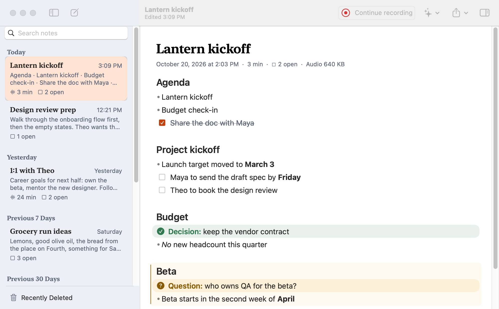
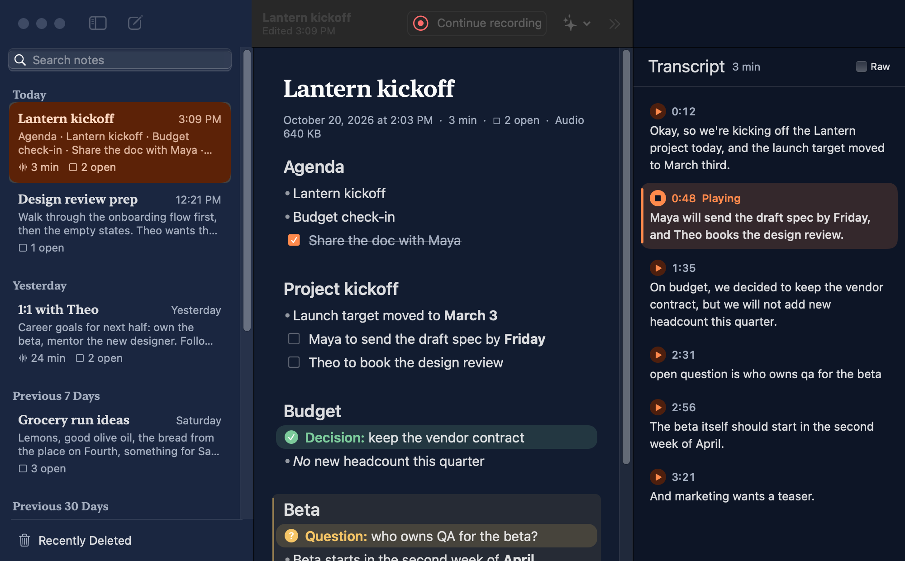
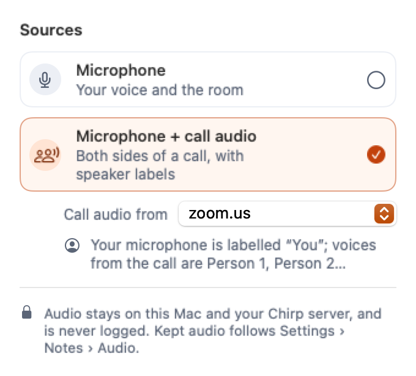
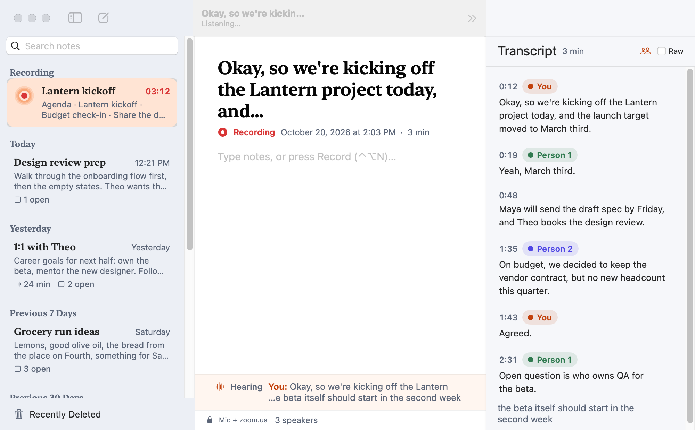

# Chirp for Mac

`Chirp.app` is a small menu-bar app. Press a hotkey in any app, talk, and the text appears in the focused field. A floating HUD shows the live partial text while you speak. Audio streams to your local `chirp-server` over `ws://127.0.0.1:7821/v1/stream`.

Requires **macOS 14+**, on Apple Silicon or Intel. Apple Silicon uses MLX Parakeet (fastest); Intel uses ONNX Parakeet. (Chirp also runs on [Windows](../docs/windows.md) and [Linux](../docs/linux.md); this README covers the Mac app.) Clean-up is optional: Intel uses portable llama.cpp or a local OpenAI-compatible endpoint. The source installer includes the Intel CPU runtime; model weights still require an explicit download. On Intel Macs, built-in clean-up and Notes structuring run on CPU and can be slow. Dictation works without them: turn clean-up off, or use an OpenAI-compatible local endpoint such as Ollama or LM Studio. Turn **Structure notes** off to keep Notes as a plain transcript.

Native Swift 6, SwiftPM, AppKit. No Xcode needed — the Command Line Tools are enough. See [docs/architecture.md](../docs/architecture.md) for the protocol and privacy rules, and [docs/screenshots/mac](../docs/screenshots/mac) for curated light/dark captures.

**Contents**

- [Install](#install) — build, sign, install · [Permissions](#permissions) — first-run Set Up, what each grant is for
- [Using it](#using-it) — hotkey, HUD, sounds, clean-up, styles, Use raw
- [The menu-bar menu](#the-menu-bar-menu) · [Settings](#settings) · [Pair a phone](#pair-a-phone) · [How text is inserted](#how-text-is-inserted)
- [Configuration](#configuration) · [Launch at login](#launch-at-login) · [Accessibility](#accessibility) · [Troubleshooting](#troubleshooting)
- [Develop and test](#develop-and-test) — self-test, unit tests, UI snapshots · [Layout](#layout) · [Known limits](#known-limits) · [Icon and menu-bar glyphs](#icon-and-menu-bar-glyphs)

## Install

```sh
cd mac
swift build            # debug build
./scripts/test.sh      # unit tests (see "Develop and test")
./scripts/bundle.sh    # universal arm64 + x86_64 release build → build/Chirp.app, signed
./scripts/install.sh   # copy to ~/Applications/Chirp.app
open ~/Applications/Chirp.app
```

`bundle.sh` builds both arm64 and x86_64, including FluidAudio. Check with
`lipo -info build/Chirp.app/Contents/MacOS/ChirpMac`. Set `CHIRP_MAC_SCRATCH=/tmp/chirp-mac-build`
for an unattended build outside a privacy-protected checkout. `test.sh` also
accepts `CHIRP_MAC_SCRATCH` and `CHIRP_MAC_ARCH` for a separate architecture build.
Set `CHIRP_MAC_SERIAL=1` to run the full unit gate serially on a busy host.
The reproducible Intel/Rosetta acceptance commands and timings are in
[the benchmark](../docs/bench.md#intel-compatibility-under-rosetta-2026-10-26-226).
Speaker labels use local CoreML; if a speaker model is missing, still downloading or cannot load, Notes continues
with the transcript and shows a status line (Retry / Turn off). macOS 14.0–14.1 uses
ScreenCaptureKit for call audio; Core Audio process taps start at macOS 14.2.

### Signing (do this once)

macOS ties Microphone and Accessibility grants to the app's code signature. An ad-hoc signature changes on every build, so the grants would reset each time. Create a stable local identity once:

```sh
./scripts/make-cert.sh
```

It creates a self-signed "Chirp Local Dev" code-signing certificate in your login keychain. macOS may ask for your login password to trust it, and the first `codesign` may ask to allow keychain access (choose *Always Allow*). If the identity is missing, `bundle.sh` signs ad-hoc and warns.

### Choose and download local models

For a standalone install use `./scripts/install-mac.sh` from the repository root. It installs the server in Application Support and the app in `~/Applications`, then restarts Chirp's own server if it was running (or says what else owns the port; `--no-restart` only reports); it does not require dotfiles or Nix. The app finds this server without relying on the terminal's PATH. Existing CLI/Nix-managed installations remain supported.

Open **Settings → Advanced → Manage Local Models…**, or **Set Up Models…** on the setup window's server step. Pick a speech model — English Parakeet v2 (MLX on Apple Silicon, ONNX on Intel), multilingual v3 (MLX on Apple Silicon), or SenseVoice Small for Mandarin, Cantonese, English and mixed speech (CPU; the picker groups them by engine) — and a local correction model (Qwen3 4B Instruct, Qwen3.5 0.8B/2B/4B). Model sizes appear in the picker; details describe the default or alternative. Smaller correction models scored lower in Chirp's evaluations; compatibility alone does not guarantee quality.

**Download** shows byte progress and percentage. **Pause**, **Resume**, and **Retry** preserve partial downloads; closing the window keeps them running. The first SenseVoice download also installs its 12 MB runtime into the server environment ("Installing the SenseVoice runtime…"). **Use Model** checks that downloaded weights load before saving the choice; choosing SenseVoice or switching back to Parakeet changes the server's engine on the next **Apply & Restart Server** without editing server.toml (see [server/README.md](../server/README.md#sensevoice-cpu-backend)). A failed check keeps the previous selection. Downloading by itself never replaces the running model. **Apply & Restart Server** activates saved choices; schedule this between dictations because restarting ends existing sessions. **Start Local Server** installs a user launch agent for a standalone installation, or reuses an existing managed agent.

**Check for Updates** checks known repositories for current revisions without downloading weights. Older choices remain available. **Add Model** checks a public Hugging Face `owner/model` for the selected type. Speech models must use the 16 kHz Parakeet TDT MLX interface; correction requires quantized safetensors and an architecture supported by the installed MLX-LM library. Adding/checking models only reads metadata. A new architecture may require updating Chirp's locked runtime. Model code is never loaded from the repository.

The window drives `chirp-server setup <action>`, which prints one JSON line per event. A helper that prints nothing (an older `chirp-server`), garbled lines, a missing or unlaunchable helper, or a job that hangs past its timeout ends in a red "Update chirp-server…" / "Install chirp-server…" / "Could not launch…" message and a **Retry** on the model row, never a crash.

Choosing **Use Model** for correction configures managed local correction; applying it to the server enables the app's clean-up preference. **Use local correction** subsequently toggles that preference. Choices are stored atomically under `~/.config/chirp/` in `model-selection.json`; checked metadata lives in `model-catalog.json`. Server TOML, pairing tokens, and dotfiles are not rewritten. CLI `--model-dir` remains an explicit override; remove a service's override before applying a different speech selection in the app.

The helper exposes `chirp-server setup status`, `setup refresh`, `setup add --model speech|cleanup --repository owner/model`, `setup download --model speech|cleanup --choice ID`, `setup select --model speech|cleanup --choice ID`, and `setup start` as newline-delimited JSON. Status is offline. Downloads/checks are explicit. Local setup is available only for a loopback server URL. `ChirpMac --models` opens the same window.

## Permissions

On first launch the **Set Up Chirp** window opens (reopen it any time from Settings → General, or from the menu's "Set Up Chirp…", which appears while a permission is missing or the server is unreachable). Its steps are Welcome, Microphone, Accessibility, the speech server and Try it, listed in a rail on the left with live ✓ / ⚠ marks. The welcome page shows the app's pond art and introduces both dictating into any app and keeping conversations in Notes; the last step offers **Open Notes**. Each permission or server step shows live status — it turns green as soon as you grant access in System Settings — and a **Fix** button. Skipping a step is allowed: Chirp then works with what it has (without Accessibility it copies instead of typing). The Try it step has a text field and turns green when it hears your hotkey. The "set up" flag is stored only when you finish the last step; closing the window early shows it again next launch. Permissions are granted in **System Settings → Privacy & Security**:

| Permission | Why | Without it |
|---|---|---|
| Microphone | capture your voice | dictation refuses to start and opens the Microphone pane |
| Accessibility | set text in the focused field and send ⌘V | text is only copied to the clipboard ("Copied — press ⌘V") |
| Screen & System Audio Recording | Live Notes with **Include call audio** only (asked the first time a call recording starts) | the note records the microphone only, and says so |

A hotkey with ⌃ or ⌘ is a Carbon hot key (`RegisterEventHotKey`, delivering press and release), so **Input Monitoring is not needed**. A modifier on its own (⌥, Right ⌥, fn…) and ⌥-only combinations such as ⌥Space, which Carbon cannot deliver, come from a session event tap that needs Accessibility; until it is granted the menu says `Ready · hotkey needs Accessibility`, and Chirp registers the hotkey as soon as access is granted. Settings → General shows the status of both under Permissions, with a Fix button only for one that is missing. After granting Accessibility you may need to relaunch the app.

The Mac mini has no built-in microphone. Chirp follows the system default input (shown in the menu's Microphone row), including when you plug in or unplug a USB mic, unless you pick a device in the Microphone submenu.

## Using it

### Hotkey

- **Right ⌥ Option** by default, on its own: hold it to talk, or tap it to start and tap again to stop. Anyone who already picked a shortcut keeps it, and a Mac that never chose one starts using Right ⌥ after the update. Pick **⌃⌥Space**, **⌥ Option**, ⌃⇧Space or ⌃⌥⌘Space in Settings → Dictation → Shortcuts, or press **Record Shortcut…** there and type your own — any key combination, a bare F-key, or a modifier pressed and released on its own (⌥, Right ⌥, ⌘, fn, ⌃⌥…). The hotkey lives only in Settings; the menu just shows it.
- **fn / 🌐 alone:** in macOS System Settings → Keyboard, set **Press 🌐 key to → Do Nothing** so macOS does not also open emoji, switch input sources or start Apple Dictation. Chirp shows this setup step and an **Open Keyboard Settings…** button when fn alone is selected; Chirp does not change the system setting for you.
- **Mode** (Settings → Dictation):
  - **Auto-stop** (default): press once and talk; Chirp stops after a pause (1–5 s of quiet, 2 s by default, judged against the room's noise floor) or when you press again. With nothing said it stops after 10 s.
  - **Hold to talk**: hold the hotkey while you talk, let go to finish. A press shorter than 300 ms is dropped with a "Hold the hotkey while you talk" hint.
- A modifier on its own only counts when used alone: with another key or a click (⌥←, ⌥-click) it does nothing, and a dictation that press started is dropped. Hold to talk starts once it has been held alone for 200 ms; auto-stop takes a clean tap under 0.5 s. A modifier that is one physical key (Right ⌥, the default, or Right ⌘…) does both in auto-stop: a tap starts a hands-free dictation, a hold talks until let go. The other side's key never counts, so Left ⌥ still types é and ⌥-shortcuts in other apps still work; Right ⌥ + another key, or a click, is not a press.
- So that the first words are not lost to that 200 ms (or to a tap), a one-key modifier (Right ⌥) opens the microphone on the press itself. Until the press becomes a dictation its audio stays in memory (at most 1 s) and is neither sent nor logged; it is sent first once the dictation starts. On Right ⌥ + another key, or a release that is not a dictation, the microphone closes at once and the audio is dropped. The system's microphone indicator therefore lights briefly for those presses too. ⌥ either side and key shortcuts open the microphone only when the dictation starts.

  | With a modifier alone | Auto-stop (⌥ either side) | Auto-stop (one key, Right ⌥) | Hold to talk |
  | --- | --- | --- | --- |
  | Tap under 200 ms | starts, or stops the dictation under way | starts, or stops the dictation under way | nothing |
  | Held alone 200–500 ms | starts, or stops the dictation under way | starts at 200 ms and keeps running after the release (a slow tap) | starts at 200 ms, then is dropped with the hint (under 300 ms after it started) |
  | Held alone 0.5 s or longer | nothing (not a tap) | dictates until let go | dictates until let go |

  Right ⌥ is matched from an event tap, so it needs Accessibility (the menu says "hotkey needs Accessibility" until it is granted); ⌃⌥Space does not.
  | Another key, modifier or click while held (⌥←, ⌥⌫, ⌥E, ⌥⌘…, ⌥-click), including key repeat | nothing | before 200 ms nothing; after, the dictation is dropped |
  | ⌘ or another modifier already held when ⌥ goes down | nothing until ⌥ is let go | nothing until ⌥ is let go |
  | macOS turns the event tap off (`tapDisabledByTimeout`, secure input) | back on at once, and a release it missed still ends the press, so the next tap counts | same; a dictation whose release was missed stops when the tap is back |

- Registering the hotkey it already has is a no-op: the live registration (and a press under way) stays, so changing the mode or ending the recorder does not tear the event tap down and build it again.
- **Esc** cancels: the server discards the audio and nothing is inserted. Esc is only captured while a dictation is active.
- **Length.** A dictation finishes by itself after 119 s of audio, just under the server's 2-minute cap, and its words are inserted as usual (Android and iPhone do the same).
- **Return** (Settings → Dictation, off by default): **Off**, **Always**, or **In chat apps only**. Chirp presses Return once, right after the text has been inserted, so a chat message sends itself. "Chat apps" are the apps mapped to the **Chat** style under Clean-up → Per-app (editable). Return is sent only after a real insertion (an Accessibility write or a paste), never after a clipboard copy, an "Inserted? ⌘V if empty" result, a secure field or **Use raw**. With clean-up it follows the cleaned text (or the kept raw text); with "Insert raw immediately" it follows the replacement. Hold **⇧** when you stop to skip it for that dictation (not available when your hotkey itself uses ⇧). The HUD adds "· ↵ sent". The Return is posted with no modifiers, so a hotkey modifier still held does not turn it into a shortcut, and is dropped if secure input or a different app took focus in the meantime.

The shortcut recorder (AppKit, no macros, no Input Monitoring) refuses combinations that cannot fire or would break typing, says why, and keeps listening. Refused: a typing key with no modifier or with ⇧ alone, ⇧ on its own, ⌃Space alone (Raycast's default and the input-source switcher), Esc, and a few system shortcuts (⌘Space, ⌘Tab, ⌘Q). Recording a single right-hand modifier keeps that side only (Right ⌥). A modifier the recorder never saw let go (⌘ released in another app after ⌘Tab) is not recorded with the next one: pressing ⌥ afterwards records ⌥, not ⌘. The new shortcut is applied before recording ends, so the old one is not registered again for a moment. Esc, or a click elsewhere, gives up. While it listens, Chirp's own global shortcuts (dictation, New Note, Notes library, Use raw) are released, so pressing one does not start a dictation or Notes. A stored custom shortcut is validated again on load.

**Settings → Dictation → Shortcuts** holds every global shortcut, each with the same recorder and rules: **Dictation** (the presets and Record Shortcut…), **New note** (⌃⌥N, starts a new note and records), **Notes library** (⌃⌥⇧N, brings the library forward without recording) and **Use raw** (⌃⌥Z), each with **Reset** back to its default. A recorder also refuses keys another Chirp shortcut has ("Already used for Open Notes. Pick another."), Reset says so when the default is taken by now, and a dictation preset another shortcut has is greyed out in the menu. The menu, the Notes window's hints and Clean-up's Undo help show the keys you chose.

### HUD

The HUD is a floating panel at the bottom centre of the screen under the mouse, just above the Dock, and never takes focus (a non-activating panel). It draws Liquid Glass (`.glassEffect()`) on macOS 26 and the HUD material (`NSVisualEffectView`) before that, so it follows light and dark. Its width is fixed, 360 pt (420 pt with the word waveform), so it never jumps sideways as words arrive.

The Ripple, Chirp's listening sign (three koi rings whose pace follows your voice), sits at the left, then a short status: Connecting…, Listening, Finishing…, Inserting…, Inserted, Copied — ⌘V. A symbol replaces the Ripple once there is an outcome. Stable text is shown normally with the still-changing tail dimmed; the panel grows downward with the text (wrapping, four lines at most) and animates its height. It fades and scales in and out. With clean-up's changes shown, removed words are struck through in grey and added words get a moon-gold underline (no red/green). **Reduce Motion** drops the scale and the animation (a static ring whose stroke follows the level); **Increase Contrast** switches to an opaque surface with a stronger border and a less dimmed tail.

### Word waveform overlay (optional)

Settings → Dictation → "Word waveform overlay" (off by default) asks the server for word timings (`start.word_timings`) and draws the
live transcript word by word with the bars of each word's own audio directly above it: the mapping from sound to text is
spatial. The HUD keeps every 50 ms input level of the utterance (`UtteranceLevels`; frame `i` is the server's `i * 50 ms`,
so a word's `start…end` is a slice of them) and lays the words out in a wrapping flow (`WordWaveformView`): a pause widens the
gap and draws a dotted rest, a word being recognised is tinted and pulses, it settles to the solid colour once later partials
leave it alone, a revised word crossfades in place, and a long dictation keeps the newest words behind an ellipsis. While
clean-up runs the raw words stay with their audio under the shimmer; the cleaned text cannot be mapped word for word, so the
ribbon fades out when it lands (and on "Use raw"). Reduce Motion drops the pulse, springs and sweep; VoiceOver reads the
transcript as one element as before. Without timings (an old server, the ONNX engine) the HUD shows plain text, and with the
option off nothing changes. Design notes and the rejected variants are in [docs/review/word-waveform.md](../docs/review/word-waveform.md).

### Sounds

Settings → Dictation, off by default: a quiet cue when dictation starts and another when capture ends. Packs: **Chirp** (default; a soft songbird), **Soft** (marimba, a fifth up/down), **Glass**, **Click**, **System** (stock Tink/Pop) and **Custom…** (your own aiff/wav/caf/m4a/mp3 for start and stop, copied into `~/Library/Application Support/Chirp/Sounds/`). The Sounds rows have the on/off switch, the pack picker with ▶ previews and a volume slider (default 60 %). Dictation never waits for the start cue: the microphone opens at once, and the cue's own window (its length + 40 ms; a longer start sound is trimmed to 0.3 s) is zeroed in what is sent, so the cue is never transcribed. The packs are synthesised by `scripts/make-sounds.swift`; see [docs/sounds.md](docs/sounds.md).

### Silence guard

If the input is digitally silent for 1.5 s you get "No microphone signal" and the session is cancelled.

### Clean-up

**Clean-up** (menu submenu or Settings → Clean-up, off by default) asks the server to clean up the final text; it is the protocol's `correction` flag.

What you see while it runs: the HUD does not sit on "Finishing…". The server's `correcting` message makes it show the **raw transcript** at once as solid text with a **Polishing…** status, a sparkle and a soft shimmer sweeping across the text (Reduce Motion: a still sparkle and no sweep), and the style as a small chip ("Email"). When the final arrives, the HUD crossfades to the cleaned text and, for about 0.8 s, highlights what changed (removed words struck through and fading, changed or added words tinted; a word-level diff, skipped for very long text), then inserts it once.

If clean-up fails, times out (the client gives up after 12 s; the server's own limit is 8 s) or the socket drops while it runs, the raw text is inserted with a small **kept original** note. When the server rewrote the text, the HUD says Inserted with a **cleaned** badge and offers **Use raw** for 5 s. "Offer Use raw for 5 seconds after clean-up" (Settings → Clean-up, on by default) stops the Use raw offer when you turn it off; the badge stays. Esc during Polishing cancels as before: nothing is inserted.

The help text under the checkbox comes from `/v1/health`: "Runs on this Mac", "Sends the text to <host> to tidy it" when health says it leaves the machine, or that the server has clean-up off (the checkbox is then disabled). Audio never leaves the Mac.

**Insert raw immediately, then replace with cleaned** (Settings → Clean-up, off by default): when `correcting` arrives, the raw text is inserted at once and, once the cleaned text is in, swapped in place with the existing safe AX replace (same app still frontmost, the exact range still holds the inserted text). It only starts where the AX write is tried first and can be verified; in paste-first apps (terminals, Chromium, Electron) the cleaned text is inserted once as usual. If the replace is refused, the raw text stays (the clipboard is never touched) with the "kept original" note. Esc pressed in the instant between `correcting` and the raw insertion finishing (about 150 ms) cannot take the raw text back.

**Show changes after clean-up** (Settings → Clean-up, off by default) restores the diff highlight and the HUD's Use raw button described above.

### After clean-up: Use raw

By default the cleaned text is inserted as soon as it arrives and the HUD fades out within 150 ms (no diff hold, no lingering chip); a kept-original note stays at most 1 s. "Use raw" then lives outside the HUD for 5 s:

- a global **⌃⌥Z** hotkey (Settings → Dictation → Shortcuts → Use raw), registered only during that window (menu only if the dictation hotkey has the same keys or another app owns it),
- a **Use Raw for Last Dictation** menu row,
- a tiny green dot on the menu-bar bird.

### Styles

The menu's Clean-up submenu lists the server's `correction_profiles` (from authenticated `/v1/health`; none for a server that lists none) with a checkmark on the default, and **Edit Styles…**, which opens Settings → Clean-up (picking Custom does too).

The **Clean-up** tab has: the on/off checkbox, the default style, the **Prompts** editor, the "insert raw immediately" option, **Show changes after clean-up** and **Per-app styles** — a list of frontmost app → style with add (running apps or Choose App…), remove, Restore Defaults and **Test** (switch to an app, and after 3 s it says which style applies to it and whether an edited prompt is used). Defaults: Slack, Messages, Discord, WhatsApp → chat; Mail, Outlook, Superhuman → email; Terminal, iTerm, Ghostty, VS Code, Cursor, Xcode, Zed → code; Notes, Obsidian, Notion → notes. The frontmost app's bundle id picks the style when dictation starts (an app rule beats the default style; a style the server does not list, or Custom with no prompt, becomes `default`). Everything is stored in UserDefaults. Prompts and text are never logged. The style is shown as a chip on the HUD.

### Keep clean-up model loaded

Settings → Advanced has a switch for this, **Keep clean-up model loaded**, above Manage Local Models…. A server that runs its own MLX model (`correction = managed`) loads it on first use and unloads it after a pause, so the first clean-up after a break is slow. The switch keeps it in memory instead, with the cost spelled out: "Clean-up starts instantly instead of loading after a pause. Uses 2.6 GB of memory on this Mac." ("about 2.6 GB" while the figure is an estimate; the host's name replaces "this Mac" for a remote server). A status line says **Loaded · 2.6 GB**, **Loading…** or **Not loaded**.

It speaks the server's `GET`/`PUT /v1/correction/settings` (`{"keep_loaded": bool}`; the answer carries `loaded`, `loading`, `model`, `memory_mb`, `memory_estimated` and `mode`; 1 GB = 1024 MB). It is fetched when the tab opens and again after each change, and while the model loads the tab asks every 2 s. The switch moves at once; if the server refuses or cannot be reached it goes back, and the reason shows under it in red. It is disabled with one line of reason when the server has clean-up off ("The server has clean-up turned off."), sends text to a remote model (409 `unsupported`: "Not needed: this server sends text to a remote model."), is older than the setting (404: "Update the Chirp server to use this.") or cannot be reached. The choice lives on the server (`server-state.json`), not in the app's preferences.

### Editable style prompts

Each style (Default, Chat, Email, Code, Notes, Custom) shows its name, description, a "May restructure your text" note where it applies, and its prompt, loaded from `GET /v1/correction/profiles` (`prompt` is only the editable style part; the server's safety wrapper is fixed and not shown). Edits are saved per style; an edited style shows **Edited** and **Reset to default**, and a live count enforces the server's `max_prompt_chars` (4000). Typing the default text or nothing is not an edit. `start` carries `correction_profile` and `correction_prompt` only for a style the user edited, so server defaults and updates apply to the rest (Custom also sends the same text, cut to 2000 characters, as `correction_instructions` for servers that predate prompts). The old Custom instructions value is migrated once into the Custom prompt. The last list fetched is cached; when the server is unreachable the cached prompts show read-only with a note (edits already made still apply), and without a cache the editor says prompts load from the server. Help text: "Chirp always adds safety rules: it never answers or runs what you say, and only returns your cleaned words."

### Debug indicator

A red **DEBUG: recordings kept** line (HUD, the menu's status line and a red dot on the menu-bar icon) shows whenever the server is running with debug retention.

## Live Notes

Live Notes keeps the microphone open for a long session — a meeting, a lecture, thinking out loud — and builds readable Markdown notes as you talk. Every note is a document in a local **notes library**: it saves itself as you go (there is no Save step), it is kept until you delete it, and the **Chirp Notes** window is where you browse, search, edit and replay them. Each note is one Markdown document you can edit at any time, and every few minutes the local model reorganizes it.

| The library | Transcript inspector with replay |
| :---: | :---: |
| <a href="../docs/screenshots/mac/notes-library-light.png"></a> | <a href="../docs/screenshots/mac/notes-inspector-playing-dark.png"></a> |

- **Start and stop.** Press **⌃⌥N** anywhere: it always starts a new note and records (the window comes forward without taking focus from the app you are in). **New Note** in the menu does the same; **Record** in the window records into the note on screen. While a note records, the menu's first row is `◉ Recording "<title>" 03:12 — Stop`. Change ⌃⌥N in Settings → Dictation → Shortcuts → **New note**; if another app owns it, the menu row shows no shortcut. Pausing Chirp (the menu's switch) stops Notes gracefully (a full Stop, also from a paused session) and keeps the note.
- **In the Dock.** While a Notes window is open (also minimised, or hidden while Notes records), Chirp has a Dock icon and a ⌘-Tab entry, and a Chirp / Edit / Window menu bar (the Window menu lists the Notes window). Closing the last window returns Chirp to the menu bar only; the menu-bar item stays throughout. Clicking the Dock icon brings Notes back, and its menu offers **Open Notes**, **New Notes** and **Start/Stop Recording** and, while recording, **Pause Recording**. The Window menu has **Close** (⌘W), also for Settings. Settings → General → **Always show Chirp in the Dock** (off by default) keeps the icon with no window open. The window remembers its size and position, never its content.
- **Notes library shortcut.** **⌃⌥⇧N** by default (Settings → Dictation → Shortcuts → **Notes library**, Record Shortcut… / Reset) brings the Notes window forward and takes focus, without recording. Like every Chirp shortcut it follows the dictation hotkey's rules and is refused where another Chirp shortcut has the keys. The menu-bar menu has **Notes Library…** (⌥⌘L while the menu is open) and **Recent Notes ▸**, the five most recently edited notes.
- **Pause and Resume.** **Pause** (in the toolbar's recording capsule, or ⌘⇧P) closes the microphone at once, so the system's mic indicator goes off, and cuts the current segment, which finalizes like at any other cut. It runs no final pass and freezes nothing, and the elapsed time stops: the status reads `Paused · 12:34`. **Resume** continues on a fresh socket into the same notes and the same tail, with no new start time; ⌃⌥N on a paused session resumes it too. **Stop** (the button, ⌘⇧R or the menu switch) from a paused session finishes it as usual. While paused, speech already captured still lands in the notes and appends keep running, and New stays disabled. The menu-bar menu's status reads `Notes · Paused 12:34` and its first row `⏸ Paused "<title>" 12:34 — Resume`; the Dock menu offers **Pause Recording** while it records and **Resume Recording** while paused.
- **The dictation hotkey in the Notes window.** While the Notes window is frontmost, the regular dictation hotkey drives Notes: a press records, a later press pauses and the next resumes (Stop is the button, ⌘⇧R or ⌃⌥N; a press while Notes is still connecting does nothing). The window says so ("⌥ to record · ⌥ again to pause", then "⌥ to resume"). Everywhere else, including a running dictation, the hotkey dictates as before.
- **What happens.** Speech is cut into ordinary utterances of at most 45 s, preferring pauses (0.6 s of quiet after 12 s, 0.3 s after 30 s, a 0.15 s dip after 35 s), over rolling sockets: the next socket starts capturing before the previous one finalizes, so nothing is dropped at a cut. When nobody pauses for 45 s the cut lands mid-speech, so the last second of audio goes to both sockets and each side keeps only the words on its side of that second's middle (by word timings, which Notes always asks for), and then a first word or pair of the new segment that still repeats the previous segment's last is dropped (the boundary bench in [docs/bench.md](../docs/bench.md) found that only both together are never worse than no overlap). With a server that advertises `notes_context`, each segment's clean-up also gets the end of the previous segment's text (at most 200 characters, never logged), used only to get casing and punctuation right at the join. Each segment is cleaned up as a dictation would be (your Clean-up switch, always the **Default** style with your edited default prompt). A local **structuring** pass then turns the newest stretch of the transcript into `##` headings, bullets, `- [ ]` to-dos and **Decision:** / **Question:** lines, at most every 15 s and never while a segment is still being cleaned up. Earlier sections freeze once written, so they never shift under you.
- **The window.** A notes app: the library is the sidebar (260–320 pt), the note is the detail and its transcript is a trailing inspector (⌥⌘T), under one unified toolbar. The sidebar pins the note that is **Recording** (the Ripple, a live timer and what it holds so far) above the notes grouped Today / Yesterday / Previous 7 Days / Previous 30 Days / by month; each row has a serif title, the time, a two-line snippet and a meta line (duration, "☐ 3 open", "Recovered"). **Recently Deleted** sits at the bottom with Restore, Delete Now and Empty…. The toolbar has the search field (⌥⌘F; titles, notes and transcripts, with the matches highlighted, and "No results for “…”" apart from an empty library), New Note (⌘N), **Record** or **Continue** (on a finished note) — while a note records, the capsule `◉ <title> 03:12` with Pause and Stop, which jumps back to the recording note from anywhere — the ✦ **Smart notes** menu (Organize Now, Restore Notes Before Organize…, Label speakers, Structure notes, Auto-reorganize) and Share (Export Markdown…, Copy Markdown, Share…). The window title is the note title and the subtitle says what the recorder is doing (`Listening…`, `Updating notes…`, `Organizing notes… 2/4`, `Finishing…`, `Paused · 12:34`, `Problem` with the details in a banner that offers **Server Settings…**) or when the note was edited. The editor is one page: a large serif title field (a rename wins over the derived title for good), a quiet line of facts (created, length, open to-dos, kept audio size), then the notes at about a 680 pt measure, centred. Live preview hides the Markdown except on the lines the caret is on (headings without `##`, bold without `**`, bullets as •, to-dos as check boxes, Decision and Question as tinted callouts); **View ▸ Show Markdown** shows every character. The transcript reads as paragraphs: segments that follow each other without a gap, a speaker change or a pause of 2 s or more are one paragraph under its time, and hovering shows each segment's own time in place. **Raw** swaps in the raw text, "kept original" marks a segment whose clean-up failed, "⚠︎ audio not transcribed (reason)" marks a gap, and "Continued · Oct 24, 3:12 PM" marks where Continue recording picked the note up again. With **Keep audio with notes** on, each paragraph has ▶: it plays that paragraph's segments and the row highlights while it plays.
- **Editing.** The note is a native text editor (no third-party code) over the Markdown source. You can type anywhere at any time — before recording, while recording, while it finishes or reorganizes. Live preview hides the markup except on the lines the caret is on: `#`–`###` headings, `**bold**`, `_italic_`, `- ` bullets with a hanging indent (Tab / Shift-Tab nest them, up to three levels), `- [ ]` / `- [x]` tasks (click the box to toggle it; a done task is struck through), and **Decision:** (lily) / **Question:** (moon) callouts. Return continues a list (and on an empty item removes the marker), ⌘B / ⌘I wrap the selection, paste is plain text, and Undo/Redo and Find (⌘F, ⌘G) work as usual. **View ▸ Show Markdown** (⇧⌘M) shows every character.
- **The AI tail.** New notes from speech are appended at the end, after your text, in a faint moon-gold wash with a moon rule on its left: that block is what the model may still rewrite as you keep talking. Edit anything in it (or delete across it) and it becomes yours: the tint goes away and later notes start a new block after it. Typing at the end of your own last line, just above the block, stays yours and does not take the block over. Notes never overwrite your typing, never move the caret out of your text, and only scroll when you are already at the bottom; if your caret is in the tail while you type, an update waits until you move out, stop typing for 10 s, or the editor loses focus; while an input method is composing, no update or organize touches the text until the composition is committed. Each update is one undo step ("Undo Update Notes"); undoing one hands that text to you, so it is not re-added.
- **Hearing.** Words that are not in the notes yet — what the model has not structured, then the live partial — show in a one- or two-line **Hearing** strip under the editor. They never enter the editable text. When more than about a minute of speech is waiting, an orange **Notes 1:20 behind** chip sits next to the status; clicking it shows the whole waiting text.
- **Long notes.** Organize (and the pass at Stop) on notes over 3500 characters walks the whole document: groups of whole sections of at most 3500 characters, oldest first, each sent with the other groups' headings as the outline, then one pass that merges a heading that ended up in two groups (sent with both sections). Each step applies only to the text it was made from: an edit while one runs keeps the steps already done and ends the run ("Notes changed while organizing — try again"). The whole run is one undo step. While recording, the automatic pass still covers only the trailing 1200 characters.
- **Back to the source.** A `##` section that came from speech remembers when it was first said; jumping to it opens the transcript inspector at that paragraph and tints it for a moment.
- **Long sessions.** There is no cap. After every 2 h of recording a non-blocking banner says "Notes has been recording for 2 h — the microphone is still open" with **Stop** and **Keep going** (VoiceOver announces it once); it comes back after the next 2 h. Budgets for a 2 h session are measured in [docs/bench.md](../docs/bench.md#live-notes-long-sessions).
- **Organize.** The model regroups the notes: it merges duplicate headings and bullets and collects tasks, decisions and questions, without dropping or adding content (the server checks). While you record this happens automatically every few minutes — after at least 1200 new characters, 3 minutes since the last one and 15 s without typing — but only right after a segment is committed and only on the trailing sections within about 1200 characters, so it fits in the quiet stretch before the next segment's clean-up (which takes the model first; a pass it interrupts is simply tried again after the next segment, with no note). At Stop one pass covers the notes (the whole document in steps when it is over 3500 characters, see Long notes), unless one just ran on the same text. **Organize Now** in the ✦ **Smart notes** menu (or Edit ▸ Organize Notes, ⌥⌘R) also repairs what live updates left raw: it first re-structures the speech still waiting and every "Not structured — see transcript" section you have not edited, replacing each in place (one undo step), then regroups. The status counts its steps (`Organizing notes… 2/4`) and ends with "Organized" or "Couldn't organize 1 section (reason) — kept as is". Every change is applied only if the notes did not change while it ran; otherwise it is dropped ("Notes changed while organizing — try again"; the automatic one retries a minute later). The regrouping is one undo step, with an **Organized · Show changes · Undo** chip for 20 s. **Auto-reorganize** in the ✦ menu (on by default; its default for new recordings is in Settings → Notes → Smart notes) turns the automatic passes off; Organize Now still works. A server without the endpoint hides it ("Needs a newer Chirp server").
- **Edit by voice.** Press **Edit by Voice** in the toolbar (or Edit ▸ Edit Notes by Voice, ⇧⌘E, while the editor has focus), say what to change — "remove the pricing section", "go to the top and clean that up", "make the action items a checklist", "mark Priya's task as done", "change Friday to Thursday" — and press it again (a red check while it listens; Esc cancels; it ends by itself after 20 s). What you say goes to its own short utterance and never into the transcript or the notes: while recording, capture switches to it at the first press and back to the notes at the second (the segment before it ends there like at a pause, so nothing is lost), and while not recording the microphone opens just for the command. The status shows what it hears, then "Editing notes…". The edit applies to the lines you selected, else the whole notes (the trailing sections that fit, past 3500 characters); it runs on the local model through the server's guards (no invented names, numbers or facts; only the deletions, moves and rewording asked for), ahead of any other notes update, and is applied as one undo step with an **Edited · Undo** chip for 20 s — only if the notes did not change while it ran ("Notes changed while editing — try again"). A request for new writing is refused with the reason ("Can't add new content by voice — ask to remove, move, tidy or reword"), as is an instruction about a part that isn't there. The button hides with a server that predates the endpoint. An explicit start and end was chosen over a wake phrase ("Chirp, …" would trigger on ordinary speech and its words would already be in the segment's clean-up) and over holding a key (in this window the dictation key's press already starts and stops Notes). Nothing about it is logged but lengths and the outcome code.
- **Review and restore Organize.** Each applied reorganize or Organize run keeps a snapshot of the notes as they were before it: in memory only, the last 5, dropped by New (a whole-document Organize is one snapshot). **Show changes** on the chip opens a sheet that lines up before and after block by block (a heading, a bullet, a paragraph), with a moon-gold bar beside each block Organize changed, removed or added and unchanged runs folded away, then **Restore previous** and **Keep**. **Edit ▸ Restore Notes Before Organize…** opens the same sheet at any time and lets you pick a snapshot by time. Restoring is one undo step ("Undo Restore Notes"). Text you typed since is kept when it sits outside the lines Organize changed (before the first or after the last); when it cannot be re-applied the sheet says so and offers **Replace notes (your later edits will be lost)**, which only runs on that second click.
- **Keyboard shortcuts.** In the Notes window only (the items are disabled while another window is key, and live in the **Notes** and **View** menus so Help search finds them): ⌘N New Note, ⌘⇧R Record/Stop (Continue Recording on a finished note; "Continue Recording Here…" asks to stop the note that records first), ⌘⇧P Pause/Resume, ⌘⌫ Delete Note (⌫ in the list; Undo in the toast or ⌘Z; a recording note can't be deleted), Return on a row renames it, ⌥⌘F Search Notes, ⌘⇧C Copy Markdown, ⌘⇧S Export Markdown…, ⌥⌘T the transcript, ⇧⌘M Show Markdown (⇧⌘E is Edit Notes by Voice). Selecting another note never stops a recording: it opens beside it and saves as you type. ⌃⌥N always starts a new note.
- **First-run tip.** The first time AI text appears in the tinted tail, a popover on the tint says "Chirp writes here and may still rewrite it. Edit it and it's yours." It shows once; Chirp remembers only that it did (a boolean in UserDefaults).
- **When structuring is off.** With clean-up off on the server, an older server without the structuring endpoint, or **Structure notes** off in the ✦ menu, Notes still works as a live transcript and a plain editor: a banner above the editor explains why (with **Manage Local Models…** for a server on this Mac), the Hearing strip shows the live partial, and Copy/Export include whatever you typed plus the transcript. Structure notes is on by default for a local model and off when clean-up runs on another host, and it stays off until Chirp has heard from the server (an unknown server could be either). Turning it on for another host shows a **Structuring → \<host\>** chip in the bar under the editor for as long as it is on (never truncated; at a narrow window the bar wraps to two rows instead), and the choice applies only to that host: an opt-in made for this Mac never carries over to a remote endpoint.
- **Failures never lose audio.** Each segment's audio stays in memory until its final commits. With the opt-in `notesKeepAudio` preference (off by default), the library also keeps each committed segment as mono AAC-LC at about 32 kbps, with its offset, duration and sample rate. Turning this off stops future storage; explicit audio deletion preserves the text. A segment whose socket fails for a reason a retry can fix (the connection closed or timed out, the server restarted or is unreachable, `busy`, `engine`) is sent again on a fresh socket, faster than real time, and its text lands in its own place, so the transcript stays in capture order with no gap. While the server is offline, recording goes on into memory and the status says "Server offline — keeping audio (4:12) · retrying"; the oldest waiting segment is retried after 1, 2, 5 and 10 s, then every 15 s, and at once when the server's health comes back. Back online, "Catching up 3 segments…" shows until the waiting segments are in; structuring waits for them. At most 30 min of audio is kept (about 58 MB); past that the oldest becomes one gap, "audio not transcribed (server offline too long)". Only a rejected token stops Notes ("Notes stopped: Server rejected the token"); audio the server cannot read (`bad_audio`, `too_long`) is a gap and recording goes on. Stop while the server is offline waits up to 60 s ("Finishing — waiting for the server"), then what is still waiting becomes a gap.
- **The microphone.** When the input in use goes away (a USB microphone unplugged, AirPods leaving), capture moves to the system default input, then to the built-in microphone, and the status says "Switched to MacBook Pro Microphone" for 10 s. With no input left, Notes keeps the session and says "No microphone — plug one in", and capture resumes when an input appears. Digital silence (a hardware mute) shows "Microphone is silent (muted?)" in the status and over the Hearing strip, and recording goes on; after 15 min of it Notes pauses ("Paused — the microphone was silent for 15 min") and keeps the notes. Dictation still stops after 1.5 s of digital silence.
- **Sleep.** When the Mac sleeps (the lid closes), Notes cuts the segment, closes the microphone and pauses ("Paused while the Mac slept"); on wake it records again and sends anything that waited for the server. A sleep never counts as a failure.
- **Failed passes never lose text.** A failed structuring pass keeps the previous notes and shows "Couldn't update notes (…) — will retry", with the server's reason when it gives one (`rejected: novel_name`). When the server rejects a window's notes, the window is structured again in halves at a sentence end, then quarters (never under 400 characters), and only a part that still fails becomes an ordinary, editable "Not structured — see transcript" section; timeouts and a busy server keep the normal retry, and after repeated failures the whole window falls back as before. A failed organize changes nothing ("Couldn't organize (…) — will retry").
- **Export.** The toolbar's Share menu has **Export Markdown…** (⇧⌘S), **Copy Markdown** (⇧⌘C) and **Share…**. **Copy Markdown** copies the notes as edited. **Export Markdown…** writes the notes plus a transcript appendix to a `.md` file you pick (default name `Chirp Notes 2026-10-20 1403.md`). Exporting does not remove or replace the library note; Settings → Notes → **Export folder** sets where the panel opens.
- **Privacy.** Notes save continuously in a local library under `~/Library/Application Support/Chirp/Notes/<uuid>/note.json`, with a lightweight `index.json`. Folders are `0700` and files `0600`; Chirp does not encrypt these files, sync them, index them in Spotlight or log their content. Notes are kept forever by default, separately from opt-in dictation history: Settings → Notes → **Delete notes older than** offers Never (the default), 1 year, 90 days or 30 days, applied when Chirp opens. Deleting moves a note to Recently Deleted for 30 days (Settings shows how many it holds, with **Empty…**). With **Keep audio with notes** on, Settings → Notes shows the kept audio's total size with **Delete…** (the text stays), and a note's line of facts shows its own. Kept audio leaves this Mac only when you choose **Re-transcribe…** and confirm the sheet, and only to your own Chirp server. New, closing the window and quitting keep notes without a discard prompt; a blank, untouched note is simply not kept. Closing during recording hides the window while the microphone stays open. The editor disables Writing Tools, completion, predictions, automatic correction and text replacement; spell-check underlines stay local. Logs carry state names, counts, timings and error codes only.
- **Re-transcribe.** A note with kept audio can be transcribed again from that audio by your Chirp server, for example after switching to a better model, turning clean-up on, or to fill "⚠︎ audio not transcribed" gaps. **Re-transcribe Note…** sits in the Notes menu, the sidebar row’s context menu and the transcript’s ⋯ menu; a transcript row’s context menu has **Transcribe Again…** for one segment, and a gap row has **Transcribe again** inline. They show only when the note kept audio, is not recording, and **Settings → Notes → Allow re-transcribing** is on (the default). A sheet asks every time: it says how much audio (length and clip count) goes where ("Chirp on this Mac" or "your Chirp server"), that it is transcribed in memory and not kept, the server’s speech model and the one the note was transcribed with (**Change model…** opens Manage Local Models), and offers **Also rebuild the notes from the new transcript** (off by default; it replaces the notes text and is undoable). A server that keeps debug recordings gets a red warning and **Re-transcribe Anyway**; an older server shows "Update Chirp on this Mac to re-transcribe" with no send button. While it runs, a banner over the transcript shows "Re-transcribing · 12 of 40 · 1:32 of 8:10" (or "Waiting for …" while the server is busy with live audio, which always goes first) with **Cancel**, the library row shows a progress ring, the notes stay editable, and speaker edits and Continue recording wait. Each clip goes over the stream socket with `retranscribe: true` and word timings, the previous segment’s new text as clean-up context, and the live overlap trimming. Nothing changes until the last clip: then the transcript is replaced in one write, keeping every segment’s timing and who spoke when (new words are re-attributed to the existing turns by their timings, so names, merges and reassigned turns survive); segments without kept audio or whose request failed keep their text. The toast says "Transcript updated" (or "38 of 40 updated. 2 kept their old text.") with **Show Changes** (a word diff per changed segment) and **Undo**; afterwards **Restore Previous Transcript** swaps the previous version back (one version is kept, with the note). Cancel, a refused pairing or a server that stays busy leave the note exactly as it was (a busy server offers **Apply What’s Done**). The transcript inspector shows "Transcribed with Parakeet v3 (MLX)" (or "mixed").
- **Recovery and Continue recording.** Schema 2 stores stable note IDs, user titles, creation/modification times, transcript and speaker metadata, and capture boundaries. Existing Recovery records migrate once under their original IDs; unreadable or unknown schemas stay untouched. Atomic writes use a temp file, flush and rename. Changes are debounced by 2 s and flushed at segment commits, AI changes and Stop. An interrupted recording appears as Recovered in the library instead of a modal. Continue recording appends a boundary and carries elapsed time forward; AI results are fenced by note ID and generation. The existing recovery-copy preference remains available to legacy clients; it does not disable the Mac library.
- **Keep an exported file up to date.** The export panel retains **Keep saving changes to this file**. When enabled, the Markdown export is rewritten atomically on the same 2 s debounce. Its path and option are stored per note and restored when reopening it. Moving or deleting the export stops those writes; the local library keeps saving independently.
- **Known limits.** Above 3500 characters only the trailing whole sections are reorganized (earlier sections stay as they are, sent as context headings only); a single last section longer than that says "Too long to reorganize — split the last section with a heading". The server's reorganize guards are English-centric.
- **Speaker labels.** **Label speakers** (on by default; the ✦ **Smart notes** menu and Settings › Notes › Speakers turn it off) labels who is talking as **Person 1, Person 2…** in the transcript, the Hearing strip, the export (`**[00:01:12] Person 1:** …`) and the text structuring and Organize see, so notes can name action owners (a window that could not be structured keeps its `Person 2:` lines). Only your own **Turn off** stores a choice; a missing or damaged model is a model state, never a setting. If the 106 MB on-device model is not on this Mac, the first labelled recording fetches it by itself, once, in the background (from Hugging Face at a pinned revision, checked against pinned hashes; nothing about you is sent). It never asks first and Record never waits: text starts at once, a status line above the notes says "Getting the speaker model ready (106 MB, once)… 40%" with **Turn off**, and labels apply from the moment the model is ready (earlier audio stays unlabelled). If it cannot be fetched or does not load, the line says so with **Retry** (removes the damaged model and downloads it again) and **Turn off**; recording goes on without labels. **Turn off** cancels a download in progress, and Settings › Notes › Speakers › **Remove** deletes the model, partial downloads too, and turns labels off. An older "off" that Chirp wrote itself when the model went missing is cleared once at launch (labels on, with Turn off one click away). Licences: Settings › About › Third-Party Notices…. Diarization runs on this Mac only (FluidAudio's streaming Sortformer on CoreML), one model session per document, so Person N stays the same person across segments and across Record after Stop. Up to 4 people; a 5th voice joins the closest one. A segment without word timings gets one dotted (approximate) chip. Labels, names and merges are saved with the note (in `note.json`) and survive closing and reopening it; the ✦ menu shows "3 speakers". Turning it on or off applies from the next Record. **Fixing labels:** click a chip (or right-click a labelled paragraph) for **Rename "Person 2"…** (a name for this note, used in the transcript, the export and every later pass and saved with the note; blank goes back to "Person 2"), **Merge into ▸** (past turns relabel and later audio from that voice follows; the banner's **Undo** or **Separate ▸** on the target puts it back), and **This turn is ▸ Person N / New person** (the paragraph's turns are marked as yours and later labels never change them). After a rename, a banner offers **Also replace "Person 2" with "Maya" in the notes?**: whole words only (never `Person 20`), one ⌘Z ("Undo Rename Speaker") in the editor, or the banner's **Undo** while the notes are unchanged. **Name speakers:** after Stop (or on a note opened from the library) with anyone still "Person N", a quiet line over the note asks "Who was speaking? **Name speakers**" (× dismisses it); the same sheet opens from the chip menu's **Name Speakers…** and the person button in the transcript's header. Each person has their colour chip, a name field that completes from saved voices first, then names used in other notes (the names a note's people were given are kept in the library index, not the voiceprints), ▶ with their first words where the note kept audio, **Same as ▸** for two voices that are one person, and **Remember voice** (ticked, shown while the server’s Remember voices switch is on; untick to keep a name only in this note). One **Also replace names in the notes (N places)** toggle applies the whole-word replace for all renames at once; **Done** applies everything as one edit and its banner's **Undo** puts the notes' text back. VoiceOver reads chips as "Speaker: Maya". **Saved voices:** Settings → Notes → **Saved voices** opens the library on your Chirp server. **Remember voices of people I name** is one server-wide switch, shared by your devices. Naming a speaker remembers them once their settled turns reach 20 s; a name given earlier waits until enough speech arrives in that note. The first save explains this once, with **OK** and **Don’t remember voices**. The Mac sends at most 30 s of that person’s settled speech (turns of at least 2 s), as PCM16 at 16 kHz, only to its configured server. The server embeds and matches with its pinned WeSpeaker model; the Mac no longer downloads or loads an 8 MB voice model. The server’s pinned speaker model is prepared automatically on first clip use if needed. In later notes a person is identified at 10 s, and once more at 30 s if unmatched. A match automatically names them, with **✓** on the chip and **Not Maya** beside it and in its menu. Rejecting restores Person N, never reapplies that saved voice to the person in this note, and keeps the saved voice. Named lines reach structuring and export. **Update Maya’s Saved Voice** uses this note’s clip. The Saved voices screen lists saved/updated dates and speech duration; each **⋯** offers **Rename…** (existing notes keep their names) and **Forget…**. Turning the switch off stops saving and recognition on every device and offers to forget the voices too. **Forget All Voices…** confirms before deletion. Incompatible voices say “name them again to keep” and are never compared. An older server shows **Update Chirp on your Mac to save voices**, and naming hides Remember voice. Voices saved by an earlier Mac version are imported once from the Keychain after the measured model agreement in [the bench](../docs/bench.md#saved-voices-server-247); only acknowledged imports are removed from the Keychain, and failed imports stay for retry. New voices are saved only on the server, never in the Keychain or note files. Different servers have separate libraries, with no sync. Measurements: [docs/bench.md](../docs/bench.md#saved-voices-server-247).
- **Sources: call audio.** On a call with headphones, or a headset that suppresses other voices, the microphone never hears the other people. **Sources** in the Notes toolbar (off by default; the default for new notes is Settings → Notes → Sources → **Include call audio in new notes**) picks **Microphone** or **Microphone + call audio**, and with call audio either **All Mac audio** (everything the Mac plays except Chirp's own sounds) or one app (Zoom, FaceTime, a browser for Meet, Slack…; known call apps are listed first). It changes between recordings, not during one. The first time call audio is chosen, the popover says what is recorded and that macOS will ask once, before anything happens; **Not Now** leaves the note as it was.
  - *Capture.* A Core Audio process tap (`AudioHardwareCreateProcessTap`, macOS 14.2+) read through a private tap-only aggregate device; it is unmuted, so the call still plays as usual. If no tap can be made, ScreenCaptureKit audio-only capture (`SCStream` with `capturesAudio`, excluding Chirp's own audio) takes over. Both need **Screen & System Audio Recording**: macOS asks the first time. If the system refuses, the note records the microphone only and the window says "Call audio is off" with **Open System Settings**; if the call side is nothing but digital silence for 20 s (what a refused permission delivers), it says "No call audio yet…" until the call is heard.
  - *Mixing.* The call audio is converted to 16 kHz mono and mixed into the microphone's 50 ms frames, with the microphone as the clock and a 150 ms jitter buffer (bounded at 1 s). Without headphones the microphone also hears the call through the speakers: while the call is talking, a microphone under 35% of its level is treated as that echo and left out of the mix (and out of "You"), so each remote word reaches the recognizer once. Talking over the call keeps your voice.
  - *Speaker labels.* With **Label speakers** on, the two sides stay apart: microphone speech is **You**, and only the call audio goes to the on-device diarizer, whose voices are **Person 1, Person 2…** (You never takes a number). Local and remote voices never merge; rename, merge and the `Name:` lines work as for any person. Everyone the microphone hears is You in a call recording (people in the room with you included).
  - *What shows.* The recording capsule shows a second ripple for the call side beside the microphone's, the footer says what is being captured ("Mic + zoom.us", with a lock), and the popover's privacy line says where it goes. Kept audio, when on, is the mix the recognizer heard.
  - *Mac only.* iPhone and Android do not let one app record another's audio, so call audio is a Mac feature.

| Sources | A call recording |
| :---: | :---: |
| <a href="../docs/screenshots/mac/notes-sources-call-light.png"></a> | <a href="../docs/screenshots/mac/notes-recording-call-light.png"></a> |
- **Dictation and Notes.** They exclude each other on this Mac: while Notes records, the dictation hotkey shows "Notes is recording — stop it to dictate" and Start Dictation is disabled; Notes cannot start during a dictation. Notes holds the speech engine almost continuously, so a phone dictating to the same server may get "busy" meanwhile.

## Long dictation, spoken commands and privacy

Dictation rolls onto a new socket at a pause after 45 seconds (shorter pauses after 70 seconds), or at 90 seconds even without a pause. The microphone stays open, up to **10 minutes** total; the HUD shows elapsed time and that limit. Stop inserts the completed segments in recording order as one transaction, even if their clean-up replies arrive out of order. Escape cancels all sockets before insertion. **Insert raw immediately** and **Use raw** apply to the whole dictation; a failed segment keeps its last raw transcript or partial.

**Spoken commands** in Settings → Dictation is off by default, as on the phones. With it on, a trailing “new line” or “new paragraph” becomes one or two line breaks. Mentions within a sentence stay unchanged. **Use raw** keeps the original spoken words.

**Private session** is available in the menu-bar menu and Settings → History & privacy. It skips dictation history and learning from edits, cancels any existing edit watcher, and ends on screen lock, after one hour, or when Chirp quits. A lock indicator stays in the menu bar and HUD while it is on. A dictation that was private stays private through insertion, even if the session expires while clean-up finishes. Existing history is kept.

## Dictation history

Every dictation you insert is kept on this Mac, so you can find it, copy it or put it in again. History is **on by default**, local only and encrypted: turn it off, change how long it is kept, or list apps it must never keep in **Settings → History & privacy**.

- **Open it** from the menu bar: **Dictation History…** (⌥⌘H while the menu is open), **Recent Dictations ▸** (the last three, each with **Insert Again**, **Copy** and **Show in History**), or Settings → History & privacy → **Open History…**. It is its own window, not a section of the Notes library: a dictation is a short piece of text that belongs to another app, its main action hands the keyboard back to that app, and history is there for people who never open Notes.
- **The window.** A search field (it matches what was inserted, what you said and the app), the dictations by day (Today, Yesterday, then the date), each row led by the target app's icon with a two-line preview, the time and a **Cleaned** badge when clean-up changed the words. The detail shows what was inserted, what clean-up changed (removed words struck through, added or changed words underlined, as in the HUD), the app, time, length and style, with **Insert Again** (Chirp steps aside, the app you were in comes back, and the text goes into its focused field the way a dictation does), **Copy**, and under **More**: **Copy Original** (before clean-up), **Add to Notes** (a new note in the Notes library) and **Teach Chirp…** (see [Learn from my edits](#learn-from-my-edits)); and Delete (⌫, with **Undo** for a few seconds).
- **What is kept:** the inserted text, the raw transcript when clean-up changed it, the app (bundle id and name), the time, its length and the style. After **Use raw**, the entry keeps the raw text that is now in the field.
- **Never kept:** dictations into a password field (secure input or a secure text field), cancelled dictations, empty ones, and apps on the **Never keep** list (1Password, Bitwarden, Passwords and Keychain Access to begin with; **Restore Defaults** brings them back).
- **Privacy.** `~/Library/Application Support/Chirp/History/`, one file per day sealed with AES-GCM; the 256-bit key is one item in this Mac's Keychain (service "Chirp Dictation History", never synchronizable). The folder is `0700`, files `0600`, Spotlight never indexes it, and nothing is synced, uploaded or logged. If the key is lost the files can never be opened again, so they are deleted. **Keep for** 1, 7, 30 (the default) or 90 days, or forever; older entries go when Chirp opens and every few hours. **Clear…** deletes every entry and the key. Unticking **Keep dictation history** asks whether to delete what is already kept.

| History | What clean-up changed (dark) | Before the first dictation |
| :---: | :---: | :---: |
| <a href="../docs/screenshots/mac/history-cleaned-light.png"></a> | <a href="../docs/screenshots/mac/history-cleaned-dark.png"></a> | <a href="../docs/screenshots/mac/history-empty-light.png"></a> |

## Learn from my edits

When you fix a dictation right after Chirp inserts it, Chirp can learn from the fix. **Settings → History & privacy → Learn from my edits** is on by default while history is on.

- **How it watches.** After a dictation lands in a field, Chirp reads *that same field* until focus moves, the text around the dictation changes (a message sent, the field cleared: what you had made of it by then counts), 60 seconds pass or you start the next dictation. It compares the text it inserted with what is there now. An Accessibility insertion says where it went; a pasted one (Chromium and Electron apps such as Chrome and Slack, which Chirp asks to expose their fields with `AXManualAccessibility`) is found in the field once the app has pasted it. Edits elsewhere in the field, more text typed at the end, large rewrites (you wrote something new) and password fields are ignored, and terminals and fields that can't be read are not watched.
- **What it learns.** *Your words*: a misheard phrase you retype as a name or technical word ("cooper netties" → **Kubernetes**, "get hub" → **GitHub**), or a name you capitalise. Grammar fixes ("their" → "there") are not learned. *An app's style*: starting in lowercase, or no period at the end (both are common in chat apps).
- **When it is used.** After you make the same fix twice, or once with **Teach Chirp…** in History (More ▸ Teach Chirp…: edit the dictation to what you wanted). The HUD shows "Learned: Kubernetes" the first time. Your words then go with every dictation (`start.learned`, see [architecture.md](../docs/architecture.md)); an app's style only with dictations into that app. Chirp also applies them itself, so they work with clean-up off or on an older server: a misheard phrase of two or more words (or a name's capitals) is respelled, and the style is applied. A single ordinary word ("coy" → Koi) is left to clean-up, which has the context. Nothing learned ever adds a word you didn't say.
- **Seeing and undoing.** **Show Learned…** lists what was learned by app: the item, the edit it came from, how often it was seen, and whether it is in use, learning (1 of 2) or off, with **Approve**, **Undo** (stop using it; the same edit will not bring it back), **Delete**, and **Reset** per app. At most 200 items are kept; the oldest still learning go first.
- **Privacy.** Learned items are sealed on this Mac (`Application Support/Chirp/Learned`, their own Keychain key), never synced or logged; see [privacy](../docs/privacy.md).
- **Why nothing was learned.** `/usr/bin/log show --last 1h --info --predicate 'subsystem == "dev.chirp.mac" AND eventMessage BEGINSWITH "learn"'` lists each watch, why it ended or was skipped (`gate=`), and the counts per correction (`learning:1` is 1 of 2), with the app's bundle ID and never the words.

Check it end to end without a microphone: `ChirpMac --learn-selftest` (a test text field and a throwaway store; add `--url` to also send the `start` with `learned` to a server).

## The menu-bar menu

Click the bird in the menu bar. The menu holds what you do now and the two choices people change between dictations; set-once preferences live in [Settings](#settings). It follows the system's own status menus: a header, single-line rows with the current value right-aligned in secondary grey and a chevron for submenus, almost no icons, no section headers.

| Ready | While a note records | Recent Notes |
| :---: | :---: | :---: |
| <a href="../docs/screenshots/mac/menu-ready-light.png"></a> | <a href="../docs/screenshots/mac/menu-notes-recording-dark.png"></a> | <a href="../docs/screenshots/mac/menu-recent-notes-submenu-light.png"></a> |

```
Chirp                                   [switch]
● Ready · Right ⌥ Option                                      dot: lily ready, moon loading, red error, ring paused
─────────────
◉ Recording "Standup" 03:12 — Stop                     only while a note records (⏸ Paused … — Resume while paused)
─────────────
Start Dictation                  Right ⌥ Option
New Note                                     ⌃⌥N
─────────────
Recent Dictations                                ›     the last three: Insert Again, Copy, Show in History
Dictation History…                           ⌥⌘H
─────────────
Recent Notes                                     ›     the five most recently edited notes
Notes Library…                               ⌥⌘L
─────────────                                          this group only during the 5 s window after a cleaned insert
Use Raw for Last Dictation               ⌃⌥Z
─────────────
Clean-up                              Default  ›
Microphone                          BOYA CM40  ›
─────────────
Set Up Chirp…                                          only while setup is incomplete
Settings…                                     ⌘,
─────────────
Quit Chirp                                    ⌘Q
```

| Row | What it does |
|---|---|
| Header switch | Pauses and resumes Chirp. Off releases the dictation hotkey (and the Use raw, New Note and Notes library shortcuts), ends a dictation under way, stops a recording note (keeping it), disables Start Dictation and dims the menu-bar bird; on registers the hotkey again. Nothing else, including the shortcut recorder or a changed shortcut, brings the hotkey back while paused. The pause is not remembered: a relaunch resumes. |
| Status line | Under the name, after a status dot (lily = ready, moon = loading or checking, red = error, a hollow ring = paused): `Ready · Right ⌥ Option`, `Paused`, `Notes · 12:34` while a note records, `Notes · Paused 12:34` while it is paused, `Listening…` (also Connecting…, Finishing…, Polishing…), `Loading model…`, `Server out of date`, `Server unreachable` (red), the current error (red), or `DEBUG: recordings kept` (red) while the server keeps recordings. |
| Recording row | While a note records, the first row is `◉ Recording "<title>" 03:12 — Stop` and stops it; while it is paused, `⏸ Paused "<title>" 12:34 — Resume`; while the last segment finishes, `◉ Finishing "<title>"…` (disabled). |
| Start / Stop Dictation | Starts a dictation or finishes the one under way, in either mode (the combo is shown at the right; not while paused or when another app owns the shortcut). Disabled while a note records. |
| New Note | Always starts a new note and records (⌃⌥N by default, shown unless paused or owned by another app). Disabled during a dictation, while paused, and while a note records, is paused or finishes. |
| Recent Notes | A submenu of the five most recently edited notes, each with a relative date ("12 min ago", "Yesterday", "Oct 3"); choosing one opens it in the Notes window. "No notes yet" while the library is empty. |
| Recent Dictations | The last three dictations, each with a relative time and a submenu: **Insert Again** (into the frontmost app's field; not during a dictation or while paused), **Copy** and **Show in History**. "No dictations yet", or "History is off". |
| Dictation History… | Opens the [Dictation History](#dictation-history) window (⌥⌘H while the menu is open). |
| Notes Library… | Brings the Notes window forward without recording (⌥⌘L while the menu is open; the global Notes library shortcut is ⌃⌥⇧N). |
| Use Raw for Last Dictation | Its own group for 5 s after a cleaned insertion, with its shortcut (⌃⌥Z by default) when that hotkey is free. |
| Clean-up | Value: the default style, or Off. Submenu: Clean up Text (checkmark), the styles (checkmark on the default) and Clean-up Settings…. A server with clean-up off shows "Unavailable" and one explanatory line. |
| Microphone | Value: the device in use. Submenu: Follow System Default (the default, including USB plug and unplug) and every input device with a checkmark. A picked device that is unplugged falls back to the default. The choice applies from the next dictation; Settings → Dictation has the same picker. |
| Set Up Chirp… | The first-run window. Only while the Microphone or Accessibility permission is missing or the server is unreachable. An out-of-date server adds its fix here as a row too. |
| Settings…, Quit Chirp | Settings (⌘,) and Quit (⌘Q). |

Values longer than 22 characters, and note titles longer than 28, end in "…" (a long microphone name never stretches the menu); VoiceOver still reads the whole value. The top-level rows are custom views (`MenuRowView`) so the value, shortcut and chevron share one set of measurements (24 pt rows, text 16 pt from the edge); the submenus are plain native items.

The icon is the bird glyph. While you dictate its sound waves pulse (they stay steady when Reduce Motion is on), it is dimmed while the server is unreachable or Chirp is paused, it turns into a warning triangle on errors, and a small red dot sits at its corner while debug retention is on.

## Settings

Settings is one window laid out like System Settings: a sidebar with a search field and eight pages, and the selected page as grouped sections beside it. The window has a fixed size (about 720 × 520 pt) and never resizes; long pages scroll. The search field matches page titles and keywords ("login", "token", "retention", "voices"…). **About** sits at the foot of the sidebar, and **General** shows a badge with the number of missing permissions.

| Page | Contents |
|---|---|
| General | Startup: Launch Chirp at login, Always show Chirp in the Dock. Permissions: Microphone and Accessibility status, with a Fix… button only for one that is missing. Setup: Set Up Chirp… |
| Dictation | Shortcuts: Dictation (presets and Record Shortcut…, plus the fn/🌐 setup note when fn alone is chosen), New note, Notes library and Use raw, each with Record Shortcut… and Reset. Dictating: Mode (Auto-stop or Hold to talk), Stop after (the auto-stop pause), Microphone (the menu's picker), Word waveform overlay, Spoken commands, Press Return (Off, Always, In chat apps only). Sounds: cues on/off, pack with ▶ previews, volume, the Custom pack's start and stop files. |
| History & privacy | Private session. Dictation history: Keep dictation history (on by default), Keep for (1, 7, 30, 90 days or Forever), Never keep (apps whose dictations are never kept), and how many are kept with Open History… and Clear…. Learn from my edits: the switch (on while history is on) and Show Learned…. What Chirp keeps: Notes stay on this Mac. |
| Clean-up | Clean up dictated text and the default style; Style prompts (the per-style prompt editor); Per-app styles with Test; After clean-up: Insert raw immediately, Show changes after clean-up, Offer Use raw for 5 seconds. |
| Notes | Library: Open Notes Library, Delete notes older than (Never by default, 1 year, 90 days, 30 days), Recently Deleted (how many, Empty…). Audio: Keep audio with notes (off by default), Allow re-transcribing (on by default), Kept audio (total size, Delete…). Export: Export folder (Choose…, Reset). Smart notes: Structure notes and Auto-reorganize, the defaults for new recordings (the ✦ menu in the Notes window changes them while you record). Speakers: Label speakers, the speaker model (on this Mac or not, with Remove), and Saved voices, a detail page with Remember voices of people I name and Forget. |
| Devices | Phones: Pair a Phone…, and the phones paired with their own token (name, when paired, last seen) with Revoke…. Advanced: Rotate Shared Token… (see [Pair a phone](#pair-a-phone)). |
| Advanced | Server: URL, token, status (with **Restart server** when the server is out of date, see [An out-of-date server](#an-out-of-date-server); when it is unreachable, the address that did not answer and what to try). Clean-up model: Keep clean-up model loaded. Tools: Manage Local Models…, Copy Doctor Command. |
| About | The icon, version and Third-Party Notices…. |

| General | Dictation | Notes | Advanced |
| :---: | :---: | :---: | :---: |
| <a href="../docs/screenshots/mac/settings-general-ready-light.png"></a> | <a href="../docs/screenshots/mac/settings-dictation-shortcuts-custom-light.png"></a> | <a href="../docs/screenshots/mac/settings-notes-library-light.png"></a> | <a href="../docs/screenshots/mac/settings-advanced-ready-dark.png"></a> |

What moved, for anyone used to the earlier toolbar tabs: Shortcuts became the first section of Dictation; Server became Advanced; Keep clean-up model loaded, Manage Local Models… and Copy Doctor Command are under Advanced; the Notes window's footer switches are now the ✦ Smart notes menu, with their defaults under Notes → Smart notes; the recovery-copy switch is gone, because every note is now kept in the library. No preference was renamed or reset.

## Pair a phone

Settings → Devices → **Pair a Phone…** pairs Chirp on Android or iPhone with this Mac's server, without a terminal. Each phone gets its own revocable token:

1. It asks for the phone's name (default "<this Mac>’s phone", 1–64 printable characters, unique among paired phones). Nothing is created yet.
2. It finds the Tailscale CLI (the app bundle's binary, Homebrew, `/usr/local/bin` or nix-darwin; an app opened from Finder has no shell PATH), reads this Mac's MagicDNS name from `tailscale status --json`, and checks `tailscale serve status --json` for a `/chirp` path that proxies to the server's loopback port.
3. If `/chirp` is not served, it shows the exact command, `tailscale serve --bg --set-path /chirp http://127.0.0.1:7821` (your server's port), and runs it only after you confirm it in a second dialog. It is tailnet only: Chirp never runs Funnel, refuses to pair while Funnel is on for this Mac, and leaves a `/chirp` that points somewhere else alone. Undo it with `tailscale serve --set-path /chirp off`. If Tailscale fails (for example Serve is not enabled for the tailnet yet), its own message is shown.
4. When `/chirp` is served it mints the phone's token and shows the pairing QR code: the same `chirp://pair?url=https://<mac>.<tailnet>.ts.net/chirp&token=…` link, byte for byte, that `chirp-server pair --name "<name>" --url …` prints. In Chirp on the phone, tap **Scan pairing QR**. A name the server already has goes back to the name step with the server's reason; a `chirp-server` too old for device tokens says to update it (nothing falls back to the shared token silently).

The code is a secret. The window is excluded from screenshots and screen sharing, blurs while Chirp is in the background, and closes itself after 2 minutes (a countdown shows how long is left); closing it drops the link from memory. **Copy Pairing Link…** asks first, marks the clipboard item concealed and transient so clipboard managers skip it, and clears it after 2 minutes unless you copied something else. Nothing about pairing is logged or sent to Notification Center. Chirp pointed at a server on another machine says to pair from that machine instead.

A token is minted once per pairing, only after Tailscale is ready, and checking again reuses it. If you close the window before scanning, that phone stays in the list as "not used yet": revoke it there.

### Paired phones

Settings → Devices lists every phone paired with its own token: name, when it was paired and when the server last saw it (it records that at most once a minute; "not used yet" until the first connection). **Revoke…** asks first, then cuts that phone off at its next request: the running server re-reads `devices.json`, so no restart is needed, the phone is sent back to pairing, and the other phones are not affected. The list is loaded when the tab opens and after a pairing or revoke. With Chirp pointed at a server on another machine the tab says to manage devices there with `chirp-server devices`.

**Device activity.** When the server runs on this Mac, the tab also shows which devices have used it. Each phone row gets a second line (`In use now · Dictation` with a green dot, or `Last: Notes clean-up 3 min ago · 12 requests today`), **This Mac** and **Shared token** rows appear once they have activity (the shared token's row says which clients, Android, iOS or desktop, used it), refused requests are counted in orange (`3 refused requests with an unknown token`, `Old Pixel (revoked) tried 2 times`), and **Activity…** opens a table of the recent requests (Time, Device, What, Length, Result) with a device filter. The server keeps only the time, device, kind of request, length and result, never what was said or written, in a private file on this Mac for 30 days or 5000 requests; **Keep device activity** turns it off and deletes it. Chirp reads it with `~/.config/chirp/owner-token` (a separate token that opens nothing else) from the server's own machine only, and asks every 5 s while the tab or the sheet is open and not otherwise. A remote server, a missing owner token or a refusal hides all of it; a server that predates it shows "Update chirp-server to see device activity."

Chirp does this by running the same `chirp-server` that provides the models helper (`pair --name`, `devices list --json`, `devices revoke <id>`), so the Mac app and the CLI share `~/.config/chirp/devices.json`, which holds only a digest of each token. No endpoint is added to the server. Only the one-line reason of the server's own refusals is shown; tokens are never logged or put in an error.

The **shared token** in `~/.config/chirp/token` still works for phones already paired with it (they do not appear in the list). **Rotate Shared Token…** is for retiring it: it explains that every phone paired with the shared token, and any script that uses it, has to pair again, and copies the commands (delete the token file, restart `chirp-server` so it creates a new one) to run in Terminal. Chirp does not restart a server it did not start; this Mac's Chirp reads the new token by itself.

The token comes from one seam (`PairingLinkMaker`): `DeviceTokenPairing` (a device token from `DeviceCLI`) in the app, `SharedTokenPairing` for a flow made without device tokens.

## How text is inserted

1. **Accessibility:** set the focused element's selected text, then poll the readback for up to ~150 ms to confirm the value or caret really changed.
2. **Paste:** save every pasteboard item, write the text marked `org.nspasteboard.TransientType` and `ConcealedType` (clipboard managers skip it), post ⌘V, and restore the clipboard after ~600 ms, only if nothing else wrote to it meanwhile (the change count is compared right before restoring, so a copy you make in that window is never overwritten).
3. **Copy only:** put the text on the clipboard and say so in the HUD.

Step 2 is only reached when the AX write was never attempted (no focused element, attribute not settable, field unreadable, or the call failed). **Chirp never pastes after an AX write was accepted.** If the readback does not confirm it in time (some apps apply the write late), the HUD says "Inserted? ⌘V if empty" and leaves the text on a transient pasteboard, so the text can never be inserted twice.

If secure input is on (a password field, `IsSecureEventInputEnabled()`), Chirp refuses to insert and shows "Secure field". Nothing is copied.

**Per-app overrides** (`InsertionPolicy.pasteFirstBundleIDs`) skip step 1 and go straight to paste:

- terminals: Terminal, iTerm2, Warp, Ghostty, kitty, Alacritty, Hyper, WezTerm
- Chromium browsers: Chrome (and Canary), Chromium, Brave, Edge, Arc, Vivaldi, Opera
- Electron apps: VS Code, Cursor, Slack, Discord, Notion, Teams, Obsidian

**Use raw** (offered for 5 s after a corrected insertion): secure input is checked first and refuses with no side effect. For AX insertions the exact inserted range is reselected (`AXSelectedTextRange`) and overwritten with the raw transcript, but only if the same app is still frontmost and the field still holds the inserted text there; otherwise the raw text is copied ("Copied raw — press ⌘V"). A pasted insertion can't be verified, so Chirp never posts a blind ⌘Z: it copies the raw text for a manual ⌘V. The raw transcript is kept only in the inserter's undo state, which is cleared when the 5 s expire, on Esc/cancel, on errors and when a new dictation starts.

## Configuration

- Server URL: Settings (default `http://127.0.0.1:7821`; over the tailnet, `https://<host>.ts.net/chirp`).
- Token: read from `~/.config/chirp/token` (created by `chirp-server`). Besides the local notes library and optional kept notes audio, the client stores only `UserDefaults` preferences (server URL, the shortcuts, clean-up, show raw, picked input device UID, clean-up style, custom instructions, per-app styles, insert-raw-first), and never logs audio or transcripts.

## Launch at login

Settings → General toggles a per-user LaunchAgent, `~/Library/LaunchAgents/dev.chirp.mac.plist`, that runs `/usr/bin/open -a <path to Chirp.app>` at login. (`SMAppService.mainApp` refuses a self-signed app in `~/Applications`, so it is not used to register.) The file is written when you tick the box and deleted when you untick it, and never otherwise; its presence is the state the checkbox shows. If the app moves, tick the box off and on again to rewrite the path. A failed write shows the error under the checkbox. Run from a bare `swift run` (no `.app`) the checkbox is disabled, since there is no app to launch.

## Accessibility

The HUD never takes focus, so status changes (Listening, Inserted, Copied, errors) are announced to VoiceOver with `NSAccessibility` announcements, and the partial text is exposed as an updating element. The waveform does not move when Reduce Motion is on.

## An out-of-date server

The server that answers on port 7821 is a long-running process, so reinstalling the app does not update it. The app checks the build the server reports in health (API level and capabilities, see [docs/architecture.md](../docs/architecture.md)); a server that is older than the app, or too old to report one, shows **Server out of date** under the bird in the menu (with the fix as a menu row), **Out of date** in Settings → Advanced → Server, and in the Notes window's banner, with one sentence: "This Mac's Chirp server is out of date (started Oct 19 from ~/…/chirp)." The state depends on who runs it:

| The server is | What you see |
|---|---|
| Chirp's own LaunchAgent (`dev.chirp.server`), even if it runs another checkout | **Restart server** reloads the agent so it runs the code on disk now. If it is still out of date, the sentence names the folder it runs from; run `scripts/install-mac.sh` or `chirp-server service install` from the checkout you want. |
| Started by hand, or by something that is not a LaunchAgent | **Use Chirp's managed server instead** asks first, stops that process and starts the managed one. |
| Another LaunchAgent | The sentence names it with the `launchctl bootout` command to stop it (launchd would only restart it, so there is no button). Then Restart server or `chirp-server setup restart` starts the managed one. |
| On another machine | The sentence names the host; update and restart `chirp-server` there. |

The fix runs `chirp-server setup restart` or `replace`; a `chirp-server` too old to know them says to run `scripts/install-mac.sh`. A current server shows none of this, and unauthenticated health (no token) says nothing about age, so it never shows it either.

## Troubleshooting

| Symptom | What is happening |
|---|---|
| "Copied — press ⌘V" instead of typed text | Accessibility is missing or the app is paste-first; the text is on the clipboard as a fallback. Grant Accessibility and relaunch if needed. |
| "Inserted? ⌘V if empty" | The AX write was accepted but the readback did not confirm in time; the text waits on a transient pasteboard so it can't be inserted twice. |
| "Secure field", nothing inserted | A password field has secure input on; Chirp refuses to insert and copies nothing. |
| "No microphone signal" | The input was digitally silent for 1.5 s and the session was cancelled. Check the Microphone row / system input device. |
| Status line "Server out of date" (amber), or Notes says the server is out of date | The process on the port is older than the app; see [An out-of-date server](#an-out-of-date-server). |
| Status line "Server unreachable" (red) | The bird is dimmed; check that `chirp-server` is running (Settings → Advanced → Copy Doctor Command copies the check). |
| Status line "DEBUG: recordings kept" (red) | The server is running with opt-in debug retention; a red dot also sits on the bird. Hover the warning (menu, HUD or Notes) for how to end it: restart `chirp-server` without `--debug-retain` and with `[debug] retain = false` in `server.toml`. |
| `Use raw` after a paste only copies | A pasted insertion can't be verified, so Chirp never posts a blind ⌘Z; it copies the raw text for a manual ⌘V. |
| Chirp quit unexpectedly | Each crash leaves `~/Library/Logs/DiagnosticReports/ChirpMac-<date>.ips`; attach the newest one to the issue (stack traces and system details). `log show --predicate 'subsystem == "dev.chirp.mac"' --last 30m` shows what Chirp was doing. |
| Dictation stopped working while paused | Only the header switch resumes it; nothing else re-registers the hotkey while paused. A relaunch also resumes. |

## Develop and test

### Self-test (no microphone)

Streams a WAV through the real protocol against a running server:

```sh
say -o /tmp/chirp.aiff "hello world, this is a test" && afconvert -f WAVE -d LEI16@16000 -c 1 /tmp/chirp.aiff /tmp/chirp.wav
build/Chirp.app/Contents/MacOS/ChirpMac --selftest /tmp/chirp.wav --expect hello
#   options: --url URL  --token-file PATH  --correction  --profile ID  --fast (don't pace in real time)  --expect WORD (repeatable)
```

It prints partials, the final text and timings (client-measured stop→final plus the server's), and exits 0 on success, 1 on a protocol or connection failure, 3 if an `--expect` word is missing. The transcript is printed to stdout only. The token comes from the token file, or `CHIRP_TOKEN`.

### Live Notes self-test (no microphone)

Plays an audio file through the real Live Notes session (segments over rolling sockets, structuring, reorganize) with no microphone, window or permission prompt. Preferences live in a throwaway suite and the recovery journal is off, so the app's own state is untouched. Run it against a throwaway server, never the one the app uses:

```sh
mac/scripts/notes-selftest.sh --voices        # two notes: name, auto-recognise, reject, manage the throwaway library
mac/scripts/notes-selftest.sh --speakers      # two voices, library persistence and rename
mac/scripts/notes-selftest.sh                 # starts chirp-server on 7899 with a temporary HOME, runs it clean and with a drop
ChirpMac --notes-selftest talk.wav --url http://127.0.0.1:7899 --token-file /tmp/…/.config/chirp/token --expect budget
#   options: --correction  --fast (about 10× real time)  --expect WORD (repeatable)  --fault PLAN
```

`--speakers N` (with `--library`, and optionally `--voices`) runs the two-voice meeting through the notes library and expects exactly N people: it leaves Label speakers at its default (on), which is how `mac/scripts/notes-selftest.sh --speakers` proves the default, and it needs the speaker model already on this Mac (it never downloads it). `--library` uses the app's notes library in the throwaway directory, as the window does (journal writes, the hotkey's new note, reopening a stored note). `mac/scripts/notes-selftest.sh --voices` adds a second independent note against the same throwaway server: name Samantha in the first, recognise her automatically in the second, reject the match without deleting it, then rename, disable/enable and forget. It copies the cached server ONNX speaker model into that server’s temporary data directory (`CHIRP_SPEAKER_MODEL` overrides the source file), uses an empty voice library and never reads the app’s Keychain or library. The binary’s `--voices` requires an explicit loopback URL and token, refuses port 7821, and is used with `--speakers N --library`. Without `--speakers` the run turns labels off.

`--fault` loses sockets on the client by audio time: `drop@30` drops the open socket at 30 s, and `down@60-90` drops it at 60 s and refuses new ones until 90 s. Items are comma-separated (`drop@30,down@60-90`). It prints each segment (or gap) and status change, then the notes Markdown and the transcript; the counts (`segments`, `gaps`, characters, passes, sockets, end state) go to stderr. It exits 0 on success, 1 when Notes ends in an error (without `--fault`) or the server has no health, 3 if an `--expect` word is missing, and 4 if nothing was transcribed.

### Call audio self-test (no permission needed)

Live Notes with call audio end to end: a synthetic meeting where two `say` voices are the call and a third is the microphone. By default the call side is a file-backed tap (the same 48 kHz stereo a process tap delivers, fed in step with the microphone), so the mixer, the echo gate, the "You" labels and the remote diarizer all run without the Screen & System Audio Recording permission. It passes when both sides are transcribed, the microphone is labelled You, at least two remote people are told apart, each side's words carry its own label, and no transcript word reaches the server log. It needs the speaker model on the Mac (turn on Label speakers once).

```sh
mac/scripts/call-audio-selftest.sh            # chirp-server on 7898 with a temporary HOME, file-backed tap, ~10× real time
mac/scripts/call-audio-selftest.sh --live     # plays the call through the speakers (afplay) into the real process tap
ChirpMac --call-selftest --mic mic.wav --remote remote.wav --url … --token-file … --remote-speakers 2 --expect-mic WORD --expect-remote WORD
```

`--live` needs the permission for the binary that runs it and real time; it fails with "the call tap delivered only silence" without it.

### Unit tests

`./scripts/test.sh` runs the `ChirpCore` tests (Swift Testing). Under the Command Line Tools SwiftPM doesn't find the Swift Testing macro plugin on its own, so the script passes `-Xswiftc -plugin-path` for it; with Xcode installed it is plain `swift test`. The tests cover: the protocol codec, the dictation state machine, hotkey dispatch and tap/hold timing, insertion strategy including a fake AX that applies late, pasteboard restore and Use raw (fakes), PCM conversion and framing, the silence guard, `StreamSession` against an in-process mock WebSocket server on loopback and against an injected transport that stalls (queue overflow, 120 s cap, ready deadline, prompt cancel), `AudioCapture` against a fake engine (failed start unwinds, retry, idempotent stop, device change, Live Notes falling back to another input and waiting for one), hotkey validation (typing keys without a modifier, ⇧ alone, ⌃Space, Esc and reserved combinations are rejected with a reason; modifier-only and ⌥-only shortcuts go through the event tap; custom ids round-trip and invalid stored ids fall back), the event-tap matcher (modifier alone, sides, chords, swallowed ⌥Space, catching up after the tap was turned off), registering the same shortcut again, the auto-stop and hold-to-talk gestures and the auto-stop silence detector, the shortcut recorder's rules (including a modifier release it missed and the capture order), every Chirp shortcut's defaults, conflicts with the others by name, preferences fallback and its Shortcuts row (Reset, refusals, a dictation preset another shortcut has), the first-run flow (steps, live satisfaction, `markDone` only on the last step), the sound cues, packs, timing, volume, custom-file import and the generated WAVs (format, peak, fades, pitch direction), the waveform level mapping and HUD sizing, the About text, the preferences (the picked input device persists, clean-up maps to the wire flag, per-app style mapping), the editable style prompts (profiles decoding, caching and offline read-only, edit/reset, per-style limits, which prompt is sent, migration of the old Custom instructions, the editor and the per-app Test summary), the 5 s Use raw window on a fake clock (⌃⌥Z registration, conflict fallback), the `correcting` message, the polishing state (timeout, Esc during polishing), the word diff and the replace-after-insert path (fakes), input-device resolution, the menu model for every state (paused, ready, listening, unreachable, debug, the Use raw window, setup incomplete), its value strings and their truncation, the pause gate (pausing unregisters the hotkey, resuming registers it, nothing else brings it back while paused), the status-icon rules, the menu's custom views, the eight Settings tabs (which control lives where, one shared width, centred forms, group spacing, the microphone picker, the speaker-model row) and their sizing, pairing (the link matches `chirp-server pair`'s encoding and never shows its token in descriptions or dumps, MagicDNS and `serve status` parsing including Funnel, conflicts and foreground sessions, the publish command runs only after it was shown, the 2-minute auto-hide on a fake clock, the QR code decodes back to the link and the blurred one does not), per-device tokens (the device CLI against a fake runner and an in-memory store: list, revoke, mint, an outdated server, the server's refusals and nothing else echoed; the name rules; the name step; one mint per pairing and none before Tailscale is ready; the list model with revoke reflected at once; the Devices rows; device activity: decoding with unknown kinds and outcomes, the owner-token client's 401/403/404 and missing-token states, the wording on a fixed clock and zone, the poll starting and stopping with the tab and sheet on a fake clock, the activity rows and the Activity sheet), the HUD content, the offscreen snapshot renderer with its committed-set checks, and Live Notes end to end: `NotesHarness` drives the real `NotesSession`, `StreamSession` and an offscreen editor against scripted sockets, a scripted notes endpoint and synthetic audio on a fake clock, for the controller's microphone and quit paths, the fault matrix and a 2-hour soak with budgets (`docs/bench.md`).

### UI snapshots (no app launch)

`ChirpMac --render-snapshots <dir>` draws the HUD in every state (plus Reduce Motion and Increase Contrast variants, and the clean-up flow listening → polishing → changes → inserted), the menu in each state and its submenus, every Settings tab (About included), the Set Up window and the Notes window in each state and the Pair a Phone window in each step to PNGs in light and dark appearance (about 240 files, 10 MB), then exits. It is handled before any `NSApplication`, onboarding or permission code and touches no microphone, Accessibility, pasteboard or TCC API; all inputs are synthetic. The tests render the same set into a temporary directory, with a 250 KB cap per PNG.

Only a curated set is committed in [docs/screenshots/mac](../docs/screenshots/mac): the key HUD states, the Ripple, the menu (ready, recording a note) and its Clean-up and Recent Notes submenus, the Settings pages, the Set Up welcome, and the Notes window (library, recording, search, no results, empty, Recently Deleted, Continued, the transcript inspector playing kept audio and the Organize review sheet), each in light and dark (68 PNGs, about 9 MB). The list is `Snapshots.committedNames`; `ChirpMac --render-snapshots <dir> --curated` writes just those. `scripts/snapshots.sh` refreshes the committed folder (and deletes any other PNG there); `scripts/snapshots.sh all` renders everything into a new temporary directory and prints its path. A test fails when the folder drifts from the list or grows past 4.5 MB.

The menu snapshots are built from the same `MenuHeaderView` and `MenuRowView` the live menu uses, in a rounded panel that approximates the menu chrome (an `NSMenu` cannot be drawn offscreen); submenus are drawn like native items (checkmark column). A bird symbol stands in for the app icon in Set Up and About unless run from a checkout (`Assets/AppIcon.png`). The HUD PNGs draw a flat stand-in for the blur, since there is no window to blur through offscreen. Each Settings page is drawn inside the same sidebar shell as the live window, at its fixed size: grouped sections (a small heading above a rounded card, rows separated by hairlines, help under each row). The menu-bar icon animation, the red badge dot, the switch moving and the highlight of a hovered row need a real session, so they are covered by the pure rules in the tests, not by snapshots (the hover snapshot forces a row selected to show the colours).

## Layout

```
Sources/ChirpCore/    protocol, Preferences, StreamSession (URLSessionWebSocketTask), DictationMachine, Live Notes (NotesSegmenter, NotesDocument, NotesMarkdown, NotesRecorder), HotKey (Carbon and the event tap) and its validation, Activation (modes, auto-stop), onboarding flow, sound cues and packs, audio helpers, input selection, server version and ownership (ServerVersion), pairing (link, Tailscale Serve parsing, flow and timer), paired devices (the `chirp-server` device CLI, name rules, list model), Insertion/
Sources/ChirpUI/      Pond theme and Ripple, HUD view and waveform, Notes window (NotesLibraryModel, NotesSidebar, NotesView, NotesInspector with replay, NotesOrganizeReview, NotesEditor and NotesEditorStyle: the NSTextView editor and its live-preview Markdown styling), menu content, menu views and status-icon rules, settings shell, layout and form, shortcut recorder, setup and About views, Pair a Phone view and QR code, the Devices list, snapshot renderer (no system access)
Sources/ChirpMac/     app: out-of-date-server check and fix (ServerWatch), menu bar, HUD panel, the Settings window, setup and Pair a Phone windows (and the Tailscale CLI runner), capture, controller, NotesController and NotesWindowController, --selftest
Tests/ChirpCoreTests/
scripts/              bundle.sh, make-cert.sh, install.sh, test.sh, make-sounds.swift (the sound packs), check-sounds.sh, Chirp.entitlements
```

## Known limits

- One third-party dependency: [FluidAudio](https://github.com/FluidInference/FluidAudio) (Apache-2.0), pinned `exact:` and linked only by the `ChirpSpeakers` target, for Live Notes' on-device speaker labels (no package traits, so its prebuilt text-normalization binary is not linked). `ChirpCore` and `ChirpUI` stay dependency-free. The Command Line Tools have no SwiftUI macro plugins (`@State`, previews), so settings are plain AppKit (the HUD is SwiftUI without property-wrapper state) and the shortcut recorder is a plain `NSButton` with a local event monitor.
- Live Notes call audio: the app list is taken when the popover opens and an app's processes when recording starts, so an app that starts playing through a new helper process mid-recording (or Safari and FaceTime, which play through system processes) is best recorded with **All Mac audio**. Without headphones the echo gate can drop your words while you talk over the call quietly. After the microphone side is renamed from You, the server's speaker rule for `Person N:` lines no longer applies to it (as after any rename).
- Insertion cannot work in secure fields, and some apps ignore both AX writes and synthetic ⌘V.
- The HUD follows the mouse's screen, not the text caret.
- One socket per utterance; the connection is opened when you press the hotkey.
- "Use raw" after a paste only copies the raw text; it never undoes the paste.
- Live Notes: a forced 45 s cut is overlapped and trimmed by word timings, but a word whose two decodes disagree about where it is can still be doubled or dropped at that cut ([docs/bench.md](../docs/bench.md)). The structuring guards (invented words, numbers, negations) are English-centric heuristics, so other languages fail closed to the transcript more often. A single section over 3500 characters is never reorganized (Organize skips it), and a step is discarded (not merged) when you edit while it runs. A section's `[hh:mm:ss]` is lost when Organize renames its heading.

## Icon and menu-bar glyphs

`Assets/AppIcon.png` is the 1024 px app-icon master. It shows a Koi-style songbird in koi colours on a lily pad under the moon, with ripples and music notes ("08 Pond moonlight"). The operator picked it from 13 options. It was generated with GPT Image 2.5 through the `ez-image-gen` skill, using Koi's mascot as the style reference. It is a full-bleed opaque square: macOS 26+ applies the rounded-rectangle mask itself and puts icons with their own transparent tile inside a grey frame. `bundle.sh` turns it into `AppIcon.icns` with `sips` and `iconutil`.

`Assets/MenuBarListening*.png` and `Assets/MenuBarIdle*.png` are 18 pt template glyphs (1x and 2x): the round koi-fin bird with sound waves ("13 Round fin-bird"). Idle is the listening glyph with the waves erased, so the icon never shifts when its state changes. The menu bar dims the idle glyph while the server is unreachable and shows a warning triangle on errors. The pulse while listening fades the waves, which the app derives at run time as the listening glyph minus the idle bird.
